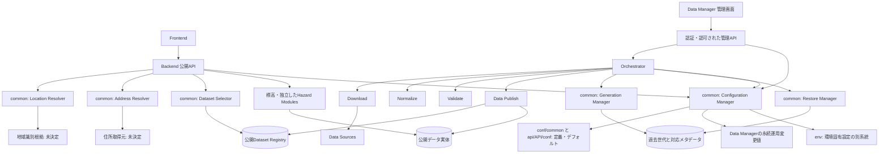

# HereRisk 基本アーキテクチャ設計 v0.1

- Task ID: `basic-architecture-design-v0.1`
- Date: 2026-10-15
- Status: Draft / OWNERレビュー対象
- 作成範囲: 文書設計のみ。実装、実行テスト、設計の最終承認を意味しない。

## 1. 目的・設計原則・確定度

HereRiskは「場所を評価するサービス」ではなく、「その場所を理解するための事実を提供する共通インフラ」である。緯度・経度を基準に住所・標高・災害種別ごとの独立したハザード情報を提供し、利用者自身の判断を支援する。危険度の総合スコア、住宅評価、安全保証、避難可否の決定は行わない。非該当も安全を意味せず、不明を非該当に変換しない。

全国対応を前提に設計し、東京都から実データ検証する。東京専用処理の複製を全国展開の方法としない。地図は必要時の詳細確認手段とする。

| 表記 | 本書での意味 |
|---|---|
| FIXED | 今回のOWNER作業指示で指定された方針、および既存文書から継承する設計要件。本書全体や参照元ドラフトの最終承認を意味しない |
| PROVISIONAL | 説明用の構成・入出力候補。正式なフィールド、型、配置、実装方式ではない |
| UNDECIDED | 未決定。必要な実装前に設計レビューとOWNER判断が必要 |

以降、責務・禁止事項・運用要件はFIXEDとして整理する。表の概念Input / Output、図の接続の具体方式はPROVISIONALであり、新しい公開API契約を確定しない。詳細の未決定事項は第11節に集約する。

## 2. 参照文書

- [Project Charter v0.5](../project-charter.md)
- [AI共通作業規約](../development/ai-development-policy.md)
- [Dataset Registry v0.1](dataset-registry-v0.1.md)
- [Data Publish v0.1](data-publish-v0.1.md)
- [Common Hazard API契約 v0.1](../api/common-contract-v0.1.md)

本書は既存文書を置き換えず、モジュール間の関係を整理する。既存契約の暫定項目を本書で確定へ変更しない。

## 3. 全体構成と依存方向

次図は将来構成を含む論理構成であり、MVP 0の実装一覧やサービス分割の指定ではない。矢印は呼び出し・参照の方向を示す。Backendは単一プロセスから開始でき、マイクロサービス化を必須としない。



Loggingと共通契約は公開側・管理側の各モジュールが利用する横断基盤であり、図では接続を省略した。Generation / Restoreがcommon内にあっても公開APIから操作できることを意味しない。

依存方向は利用側から責務別のcommon契約へ向ける。commonはFrontendや個別Hazard Moduleの内部実装へ依存せず、各Hazard Moduleは他のHazard Moduleを呼ばない。Backendは入力・呼び出し・応答を調整し、地理判定や公開処理を引き取らない。管理操作と一般公開APIの認証・認可、権限、公開範囲を分離する。

## 4. モジュールの責務とInput / Output

下表のI/Oは概念候補（PROVISIONAL）。実行結果・エラー等の意味は既存契約に従い、具体型や新規エンドポイントは未確定とする。

| モジュール | 責務 | Input | Output | 依存先・境界 |
|---|---|---|---|---|
| Frontend | 位置取得、事実と取得状態の表示 | ブラウザ位置情報、API応答 | 座標要求、表示、取得失敗表示 | 公開API。Registryや管理APIを直接利用しない |
| Backend API | 入力検証、機能呼び出し、公開用JSON構築 | 座標、対象機能、許可された個別設定 | 事実・状態・公開可能な根拠 | Resolver、Selector、機能モジュール、共通設定・契約 |
| Location Resolver | 緯度・経度から都道府県等の地域識別 | 検証済み座標 | 地域識別結果・解決状態 | 地域識別根拠。住所取得や区域該当判定はしない |
| Address Resolver | 緯度・経度から住所取得 | 検証済み座標、許可された取得条件 | 住所、粒度、取得元、精度情報、取得状態 | 住所取得元。ハザード判定やDataset選択を代行しない |
| Dataset Selector | 公開済みデータの選択 | 座標、地域、対象機能、Coverage | 選択根拠・公開実体参照、選択状態 | 公開Registryを読み取り専用で参照。判定・公開はしない |
| 標高Module | 選択根拠から標高取得 | 座標、公開データ参照 | 標高・状態・根拠 | 公開実体、共通契約。0・負値も有効 |
| 洪水・津波・高潮Module | 各種別で独立した区域該当性・浸水深取得 | 座標、各種別の公開データ参照 | 該当性・深さ・状態・根拠 | 公開実体。深さ不明を非該当にしない |
| 土砂災害Module | 区域該当性と区域種別取得 | 座標、公開データ参照 | 該当性・区域種別・状態・根拠 | 公開実体。区域の重なりを扱える契約とする |
| Configuration Manager | 定義・変更値の検証と有効値解決 | 定義、デフォルト、運用値、許可された要求値、権限、環境設定 | 検証結果、開始時の有効設定 | 第6節。運用値の永続保存方式は未決定 |
| Logging | 統一構造化ログ出力 | レベル、module、run_id、公開可能な運用情報 | 構造化ログ | ログ基盤。実行結果の代用にしない |
| 共通契約 | エラー・実行結果・データ状態等の定義 | 版管理された契約 | 利用モジュール間の共通定義 | 型・列挙値は実行時設定と分離。用途別statusを統合しない |
| Data Manager / 管理API | 運用状態の確認、権限検証、操作受付、設定変更 | 認可済み操作、設定変更・リセット要求 | 操作結果、運用状態、設定履歴 | Orchestrator、Configuration Manager。一般APIと分離 |
| Orchestrator | 起動・順序制御・終了判定 | 認可済み処理要求、有効設定 | 各処理の実行結果、全体の進行状態 | 各パイプライン・世代・復元モジュール |
| Download | 取得元データの取得 | 取得定義、取得条件 | 取得物と由来、終了結果 | Data Sources。後続を起動しない |
| Normalize | 取得物の正規化 | 取得物、処理定義 | 正規化候補とメタデータ、終了結果 | 入力候補。公開Registryを変更しない |
| Validate | 品質・整合性検証 | 正規化候補、検証基準 | 検証結果と対象の対応、終了結果 | 入力候補。検証成功は公開成功ではない |
| Data Publish | 公開資格確認、実体確定、Registry切り替え | 検証済み候補、対象ID、run_id | 公開版、終了結果 | 公開Registry更新の唯一の担当。I/O詳細はPublish設計を継承 |
| Generation Manager | 過去世代の圧縮・保持・整理 | 世代のデータと対応メタデータ、保持設定 | 整合性を確認したアーカイブ、終了結果 | 公開・使用中の参照を保護。Registry変更、復元はしない |
| Restore Manager | 展開・整合性検証・復元候補作成 | 指定世代アーカイブ、復元条件 | データとメタデータを対応させた候補、終了結果 | アーカイブ。Registry変更、公開確定はしない |
| Dataset Registry | 現行公開データ情報の正本 | Publishによる資格確認済み情報 | 公開実体・Coverage・由来等の参照 | 処理途中状態・設定変更履歴・実行履歴の保管先にしない |

Address Resolverは基本アーキテクチャの一部（FIXED）とする。住所の取得粒度（市区町村・町丁目等は例）、取得元、精度・不確実性を区別し、取得元が保証しない詳細住所や精度値を捏造しない。地域識別結果を詳細住所の取得成功とみなさない。住所の取得失敗を独立して扱い、標高・ハザード取得を不必要に停止しない。取得元、粒度の列挙値、精度表現、外部送信条件、タイムアウト、住所API形式はUNDECIDED。住所用の結果を既存Hazard APIへ無断で追加しない。

## 5. 主要データフロー

### 5.1 利用者への情報提供

1. Frontendが位置取得を行う。拒否・タイムアウト等を取得失敗として表示し、架空の座標で処理を継続しない。
2. Backendが入力を検証し、その呼び出しに用いる設定を開始時に解決する。
3. 座標からLocation Resolverで地域を識別し、Dataset Selectorで公開Registry・Coverageに基づいて根拠を選択する。
4. 各機能が選択された公開データから独立して事実を取得・評価する。将来の住所取得経路は同じ座標を入力に独立させ、住所失敗を標高・ハザードの前提条件にしない。並列・逐次方式や部分応答形式は未決定。
5. Backendが状態、事実、許可された根拠情報を公開応答へ構成し、Frontendが表示する。

データフローは `座標 → 地域識別 → 公開データ選択 → 各機能の取得・評価 → 公開応答 → 表示`。住所は `座標 → 住所取得 → 住所・取得状態の表示` として分離する。

都道府県一致やbboxだけで評価可能と断定しない。候補なし、読み取り障害、破損・参照不整合、正常な非該当を区別する。複数候補を先着順・最大値・最新優先等で独断選択しない。未公開候補・復元候補はAPIの根拠にしない。

一応答内の公開データとメタデータの世代を一致させる。公開用根拠情報だけを抽出し、Registry全体、内部パス、取得用URL、内部run_id、例外詳細を返さない。キャッシュ・参照寿命の実現方式は未決定。

### 5.2 データ整備と公開

基本データフローは **Download → Normalize → Validate → Publish**（FIXED）。この矢印は成果物の受け渡し順を示し、モジュール間の直接呼び出しを意味しない。

Orchestratorが各段階の実行結果を受け取り、SUCCESSの場合だけ次の処理を起動する。FAILEDやBLOCKED等では後続を停止して理由を返す。ログの有無やログレベルから成功を推定しない。実行結果が不明な場合もSUCCESSとして進めない。

作業中の取得物・候補・検証結果は公開領域から分離する。Validate済みでも公開資格確認を省略しない。Data Publishが実体、検証対象との対応、Coverage、出典・利用条件・再配布条件、メタデータを確認し、新しい不変実体とRegistryを準備する。公開確定点はRegistryの原子的切り替えである。具体的な格納先・排他・切り替え方式は未決定。

## 6. 設定管理

### 6.1 3階層と変更範囲（FIXED）

| 階層・区分 | 役割 | 変更主体・許可範囲 | 永続性・境界 |
|---|---|---|---|
| 1. `conf/common/` と `api/<api>/conf/` | 設定定義、デフォルト値、外部設定として管理する定数・パラメータ | 設計・設定変更の管理工程 | 管理画面の運用変更でデフォルト自体を書き換えない |
| 2. Data Manager | 永続的な運用変更値 | 認証・認可済み管理者が項目ごとの権限内で変更 | デフォルトと分離して保持。保存形式・配置は未決定 |
| 3. APIリクエスト | その呼び出しに限る個別設定 | 呼出元が明示的に許可された項目だけ指定 | 永続化しない。他の呼び出しや運用値を変更しない |
| 別系統: `env/`・秘密情報 | 環境固有設定、機密情報の管理・注入 | 環境運用の権限と承認工程 | 一般API・管理画面の上書き経路から分離。機密実環境ファイルをGit追跡しない |

各設定項目について型、許容範囲、既定値、変更可能階層、変更権限、適用対象、反映条件を定義する。具体的な項目一覧とスキーマはUNDECIDEDであり、未定義項目をAPI上書き可能と解釈しない。

| 設定の種類・例 | 一般API | Data Manager | 確定度・注意 |
|---|---|---|---|
| 呼び出し固有の調整項目 | 明示許可した項目だけ | 項目定義で許可した場合のみ | 具体項目・値域はUNDECIDED |
| 運用パラメータ（例: 保持世代数） | 許可済み項目とみなさない | 変更可否・権限を項目ごとに決定 | 保持世代数の定義・既定値はconfで集中管理。運用上書きの可否・範囲はUNDECIDED |
| セキュリティ設定、公開Registry参照先 | 変更不可 | 一般の運用変更として許可しない。個別の管理方針はUNDECIDED | 参照先の任意差し替えで公開境界を回避できない |
| 認証情報・秘密情報・環境固有設定 | 変更不可 | この設定上書き経路では変更不可 | env等の環境管理と秘密情報注入方式の詳細はUNDECIDED |
| APIの型・列挙値・状態の意味 | 変更不可 | 実行時設定として変更不可 | 共通契約の版管理・互換性レビューで管理 |

### 6.2 解決と変更の流れ

優先順位の説明例（PROVISIONAL）は、3階層すべてで変更を許可した単一項目に限り `そのリクエスト値 > 運用変更値 > confのデフォルト値` とする。全項目共通の無条件上書き規則ではない。envをこの列の最上位や最下位へ機械的に追加しない。

管理操作では認証・認可、項目の変更可否、型・範囲を検証し、変更履歴を記録する。デフォルトへ戻す操作を管理画面に設け、運用変更値を解除して定義済みデフォルトを適用する意味とする。解除の保存表現・反映時点は未決定。履歴には変更主体・対象・時点・結果等を追跡できるようにし、秘密情報を記録しない。履歴の正式スキーマ・保存方式は未決定。

処理は開始時に解決した有効設定を実行中に使用する（FIXED）。設定変更で実行途中の挙動を変えない。パイプライン全体と各段階の開始境界、設定版識別、再試行・再開時の扱い、複数項目の整合性、更新競合、再起動の要否、無効値時の応答とフォールバックはUNDECIDED。適用条件が未確定のまま暗黙の即時反映や無条件フォールバックを実装しない。

### 6.3 API独立性と設定発見（OWNER承認済み配置改訂）

Task ID: `api-isolation-contract-revision-v0.1`、2026-10-16。ルートconfへの全設定集約を廃止し、共通設定は `conf/common/`、API固有設定は `api/<api>/conf/` とする（FIXED）。各APIのコード・設定・データは原則自APIの責務に閉じ、API間の直接依存を原則禁止する。依存は各APIからcommonの契約・サービスへ向ける。単一プロセス構成も許容し、マイクロサービス・個別コンテナを強制しない。

```text
api/elevation/conf/sources.json
api/elevation/conf/sources.schema.json
api/<api>/conf/settings.json       # 将来必要な場合のみ
common/                           # 共通契約・サービスの論理配置
conf/common/                      # 共有する定義・デフォルト
env/                             # 環境固有設定・秘密情報
```

上記のうち今回実体を作成するのは既存標高定義・Schemaの移動先のみ。他API、common、共通設定、settings.jsonの空ファイルは作らない。

設定識別・発見の具体案（PROVISIONAL）は、呼出側が `(scope, api_id, config_kind)` を共通Configuration Managerへ渡す方式。scopeはcommonまたはapi。例えばapi/elevation/sourcesを一箇所の配置規則で `api/elevation/conf/sources.json` と同じディレクトリのSchemaへ解決する。共通設定はcommonスコープの `conf/common/` だけで識別する。対応API・設定種別は管理側の許可集合で検証し、任意パス、相対脱出、別API指定を一般APIから受け付けない。ルートは環境・起動設定から一度解決する。旧配置へのfallback・二重読み込みは導入しない。設定種別一覧の格納形式は未決定で、今回manifestやローダーは作らない。

解決順序案は、(1)呼出権限とAPIスコープ検証、(2)責務別の定義・既定値を発見しSchema検証、(3)そのスコープで許可された永続運用変更値、(4)明示許可された要求値、(5)全体整合性を検証して開始時スナップショットを固定、である。共通設定をAPI設定へ無条件にマージする規則ではない。同名でもcommonと各APIは別識別子とし、APIから共通値を変更・上書きする項目は明示契約が必要。一般APIの取得元・公開状態の上書きは不可。設定不正で他APIの値へfallbackしない。

将来のData Managerも同じConfiguration Managerとスコープ識別を利用し、認証・認可された範囲で永続運用変更値を更新する。既定値とは分離し、変更履歴・既定値復帰・開始時設定固定を維持する。共通項目を変更する場合は全利用APIへの影響を評価する。API固有変更は他APIの設定を再解決・改変する根拠にしない。永続化方式、反映時点、競合制御等の未決定事項は維持する。

### 6.4 API別データ領域と権限（FIXED）

```text
/data/<api>/
  dl/current/
  dl/archive/
  work/
  rel/versions/
  records/
```

これは論理領域であり今回ディレクトリは作成しない。MacとVPSの物理rootはenvで切り替え、Docker Volume/bind mount、UID/GID、権限の実現方式はUNDECIDED。

| 領域 | 所有・用途・参照境界 |
|---|---|
| dl/current、dl/archive | 元DLデータ。原則現行1世代非圧縮＋過去2世代圧縮。取得元・取得日時・checksum・設定版・処理証跡と対応させる |
| work | 取得・正規化・検証の作業領域。一般公開APIの参照対象にしない |
| rel/versions | 検証・公開済み本番参照データ。公開APIは原則自APIのRegistryが指す公開実体のみ読み取る |
| records | 当該APIのAcquisition Record・処理証跡。Source Definition・Registryと混同しない |

公開版はDataset Registryが正本。rel内に存在することやcurrentという名前・シンボリックリンクだけでは公開資格にならない。Publishの準備中実体はRegistryの切り替えまでAPIから不可視とする。Registryの物理配置自体は今回確定しない。

元DL世代と公開世代は別の保持系列とし、同じ番号・削除タイミングを仮定しない。データセット単位を基本候補とし、API領域全体の一括圧縮に固定しない。取得管理地域とCoverageは別。処理中・API参照中の実体や必要証跡を削除しない。

共通Orchestrator、Data Publish、Generation Manager、Restore Managerは、認可された対象APIの設定済み領域・操作だけを扱う。API間の内部設定・内部データ直接参照は禁止する。公開APIは取得・検証・公開処理を起動できず、API配下に取得設定が置かれていても実行権限は増えない。設定の配置・コード所有と実行権限を区別する。

バックアップ・復元ではAPI識別子、データセット、取得/公開世代、対応メタデータ・recordsの参照整合を検証する。対象外APIへの展開・上書きを拒否する。Restoreは候補を作るだけで、公開復元はData Publish経由。DL世代の復元だけでは公開Registryを切り替えない。保存形式・保持期間・整合したバックアップ取得方式、DL世代の整理と公開世代との依存確認は詳細設計対象である。

## 7. 公開・世代管理・復元

原則3世代（現行1世代＋圧縮した過去2世代）を保持する。データセット単位の世代管理と都道府県単位のRegistry管理を区別する。Generation Managerは本体と対応Registryメタデータをアーカイブし、圧縮・整合性確認・保持数管理・整理を行う。圧縮形式のtar.gz / ZIPはPROVISIONAL。

通常公開後はOrchestratorがGeneration Managerを別処理として起動する。世代管理が失敗しても、確定した公開成功を公開失敗に書き換えず、公開状態と保守処理異常を分けて報告する。後続停止は公開確定の取り消しを意味しない。

復元の成果物フローは `指定アーカイブ → Restoreによる展開・検証 → 未公開の復元候補 → Data Publishの再検証・公開 → Registry切り替え`。起動と終了判定はOrchestratorが担当し、RestoreはPublishを直接呼ばない。展開成功だけでは公開成功ではない。

旧データには旧世代のpipeline ID・版、出典、Coverage、検証情報を対応させる。新メタデータとの混在を防ぐ。空き容量不足、I/O障害、アーカイブ破損、不正なパス・シンボリックリンクを検証対象とする。

| 状況 | 維持する動作（FIXED） |
|---|---|
| 公開確定前の失敗 | 旧Registryと旧データを維持。新データで旧実体を上書きしない |
| 同時Publish・複数都道府県更新 | 更新消失や一部だけ更新された状態をAPIに見せない |
| 切り替え後に応答が不明 | 実際の公開状態を確認。無条件再実行しない |
| 圧縮・整理失敗 | 公開済み状態を保護し、世代管理異常として報告 |
| Restore失敗 | 公開Registryを変更せず、公開処理へ進まない |
| 旧世代の削除 | 現行参照なし、実行中APIの安全な参照終了、保持・復旧要件、アーカイブ整合性をすべて確認 |

参照中データを削除しない。公開前の復旧世代確保、安全な回収、チェックサム、再公開時の採番、自動ロールバック条件はUNDECIDED。原則3世代は、参照中データの強制削除を許可する上限ではない。

## 8. ログと終了ステータス

Data PublishのPipeline Execution Contractの8原則を継承する（FIXED）。

1. 各モジュールは明確な終了ステータスを返す。
2. 正常終了した場合のみ、Orchestratorが次の処理を実行する。
3. 異常終了時は後続処理を停止し、エラー情報を返す。
4. 各モジュールは統一された形式の構造化ログを出力する。
5. ログはsyslog系基盤へ集約可能とする。
6. 実行結果とログを共通の `run_id` で関連付ける。
7. 各モジュールは後続モジュールを直接呼び出さない。
8. Publish後の世代管理失敗は、公開済み状態と区別して報告する。

終了結果はSUCCESS / FAILEDを基本とし、実行不能はBLOCKED等の理由を識別可能とする。Linuxコマンドとして実行する場合は0が正常、それ以外が異常。非ゼロコード割り当てはPROVISIONAL。実行結果にrun_id、module、status、異常時error_code、必要時messageを持たせ、JSON詳細は未決定とする。

| 用途 | 区別する意味 |
|---|---|
| パイプライン実行結果 | SUCCESS / FAILED等。順序制御の正本 |
| Registryのvalidation.status | 公開対象の検証情報。公開Registryではpassed |
| Hazard APIのstatus | success / no_data / retrieval_failed / indeterminateは暫定候補 |
| ハザードのresult | affected / not_affected等の事実。安全保証ではない |

ログレベルはINFO（開始・終了・結果）、WARNING（継続可能な注意）、ERROR（失敗・継続不能）とする。ログのWARNINGだけで後続継続を決めず、終了結果を使う。

ログフィールド候補はtimestamp、level、service、module、run_id、dataset_id、pipeline_id、pipeline_version、error_code、message。必須性、日時形式、スキーマ版はPROVISIONAL。利用者の詳細位置（座標・詳細住所）、認証情報、秘密情報を記録しない。アクセスログ、プロキシ、トレース、例外収集でも位置を含むURL・本文や応答全体の記録を避ける。

Linuxのsyslog / journaldで確認できることを運用要件とする。journalctlで対象モジュール・run_idを追跡し、INFO / WARNING / ERRORを識別し、必要時にPRIORITYで絞り込めることを将来の受入条件とする。Dockerの標準出力・標準エラーからホストjournaldへ収集する方式は候補であり、ドライバー、重要度変換、保持期間は未決定。今回収集確認は行わない。

## 9. フロントエンドと将来拡張

基本表示の方向性（FIXED）は住所、標高、災害種別ごとの独立したハザード情報を中心とする。取得状態と根拠を区別し、取得できない情報を正常値で埋めない。住所表示の実装追加はMVP 0では未承認。

将来UI候補 **Hazard Shape View**（PROVISIONAL）では以下を検討する。

- 実際のハザードポリゴンを簡略化した輪郭表示。
- 現在地と方位の位置関係の表示。
- 複数ハザードの半透明レイヤー重ね合わせと、レイヤーごとの表示切替。
- ハザード区域境界までの概算距離の表示。
- 詳細確認時の周辺地図画像の表示。

将来のcommon候補としてBoundary Distance（地点と区域境界から概算距離・誤差情報を得る処理）とGeometry Simplifier（元のポリゴンから表示用輪郭を作る処理）を識別する。どちらも先行実装しない。具体I/O、アルゴリズム、対象境界、誤差・単位・更新方式はUNDECIDED。

判定用データと表示用簡略化ポリゴンは分離し、簡略化による形状誤差を正式判定へ持ち込まない（FIXED）。区域境界までの距離を「安全地点までの距離」や避難経路距離として扱わない。方位センサー、位置情報、地理データそれぞれの精度・誤差と情報取得失敗を考慮する。表示輪郭の出典・版との対応、距離計算に用いる形状、許容誤差、ライセンス、端末権限、センサー非対応時の表示は後続設計対象とする。

## 10. MVP 0との境界（FIXED）

MVP 0はCharterの定義を維持する。

| 区分 | 範囲 |
|---|---|
| MVP 0 | ブラウザ位置取得、緯度・経度表示、標高API、標高表示、位置取得・標高取得失敗時の表示、APIの単体テスト・契約テスト |
| 基本設計に含める | 地域識別・公開データ選択の責務分離、Address Resolver、設定管理、管理・公開・世代・復元の境界 |
| MVP 0への追加未承認 | Address Resolverの実装・住所表示 |
| 後続・将来 | 洪水・津波・高潮・土砂災害、管理画面の全機能、全国データ一括整備、Hazard Shape View、Boundary Distance、Geometry Simplifier、地図画像、リアルタイム情報 |

基本設計に含めた全モジュールをMVP 0で実装する要求ではない。地域識別・データ選択も、MVP 0で不要な実装を強制しない。独自総合スコアは将来候補として追加せず、提供しない方針を維持する。今回の作業ではMVP 0自体の実装・単体テスト・契約テストも実施しない。

## 11. 未決定事項と既存文書との整合確認

| ID | UNDECIDED項目 | 判断する内容 |
|---|---|---|
| U01 | 住所契約 | 取得元、粒度、精度、取得状態、API形式、利用条件、外部送信、タイムアウト・部分応答 |
| U02 | 設定定義と権限 | 具体項目、型・範囲、階層ごとの変更可否、例外、環境設定との接続 |
| U03 | 設定運用 | 永続化方式・配置、履歴スキーマ、反映タイミング、リセット、更新競合、処理開始境界、再開・再試行 |
| U04 | 地域とデータ選択 | 地域識別根拠、Coverage表現、境界包含、複数候補・競合・根拠の単複形式 |
| U05 | 公開整合性 | 複数Registryの原子性、排他、改訂識別、キャッシュ、参照寿命、公開前の復旧世代確保 |
| U06 | 世代・復元 | アーカイブ形式・配置・命名、チェックサム、参照終了・回収、再公開版、自動復元条件、詳細I/O |
| U07 | 共通API・実行契約 | HTTP・正式型・null・エラー分類、run_id詳細、結果JSON、終了コード、版移行 |
| U08 | 根拠情報 | 全国一意ID、元データ基準日のRegistry対応、評価時点の表現、再構築用入力・設定の保存 |
| U09 | ログ・環境 | syslog / journald方式・保持、日時・必須フィールド、設定ファイル形式・命名、秘密情報注入 |
| U10 | 将来表示 | 簡略化方式、距離算出根拠、精度・誤差、センサー非対応時、表示用データの版・利用条件 |

| 参照元 | 照合した要件と結果 |
|---|---|
| Charter | 全国設計／東京検証、独立機能、commonの拡張、conf/env、MVP 0を維持。住所・設定管理の追加は今回のOWNER方針による基本設計であり、実装範囲を変更しない |
| AI共通作業規約 | 文書のみ、既存契約非変更、workspace非公開、公開サマリー、自己確認と独立検証の区別、commit・push未実施を維持 |
| Dataset Registry | 現行公開情報の正本、Publishのみ更新、公開資格、Coverageと地域の区別、処理定義・履歴の非格納を維持 |
| Data Publish | 8実行原則、原子的公開、3世代、復元候補の再公開、使用中データ保護、公開後の世代管理失敗の分離を維持 |
| Common Hazard API | 状態と結果の分離、公開済みデータ限定、内部情報非公開、標高0・負値、部分結果・複数候補の未決定を維持 |

照合した範囲で既存文書との要件上の矛盾は認めなかった。Registryの「Data ManagerのPublish処理」は、管理側から起動される独立したData Publishの責務として整理した。住所契約と設定3階層の詳細は未決定事項を維持する。設定配置は2026-10-16のOWNER承認により第6.3節の責務別配置へ明示的に改訂した。運用値の永続化方式は未決定のまま、デフォルトとの分離を維持する。

追加の矛盾が見つかった場合はOWNERへ報告し、既存設計書を無断変更しない。本書の自己確認結果は[公開レビュー記録](../../reviews/phase0/basic-architecture-design-v0.1.md)に記載する。実装時の動作・整合性・障害復旧・契約テストは別工程であり、本書作成で成功を宣言しない。
