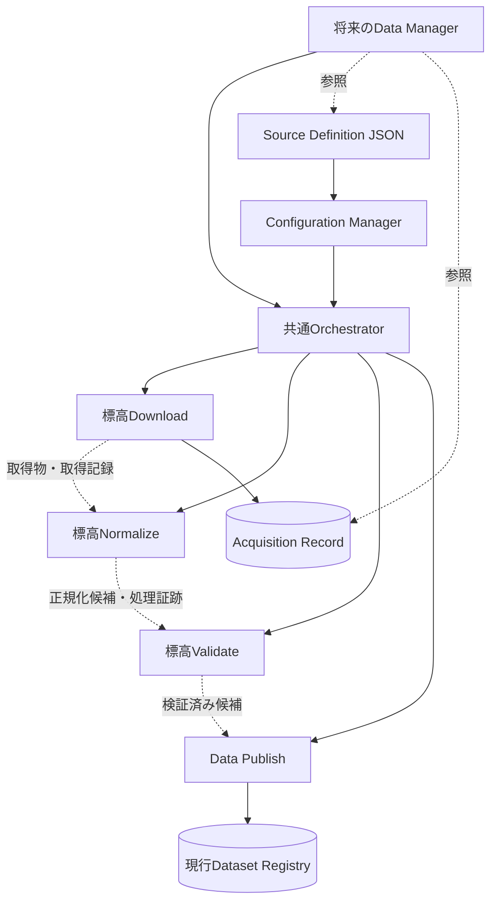

# HereRisk データソース定義・全国対応設計 v0.1

- Task ID: `data-source-definition-v0.1`
- Date: 2026-10-16
- Status: Draft / OWNERレビュー対象
- 基準main: `42891811b979863f9164cf44344056eabfcacf43`（originをfetchし、HEADとorigin/mainの一致を確認）
- 成果物: [sources.json](../../api/elevation/conf/sources.json)、[最小JSON Schema](../../api/elevation/conf/sources.schema.json)
- 対象: 設計、設定JSON、検証定義のみ。データ取得・パイプライン・管理画面の実装はしない。

## 1. 方針・確定度・参照

**FIXED（2026-10-16契約改訂）**: Source Definitionは `api/<api>/conf/sources.json` に置く。今回存在するのは標高APIの定義とSchemaだけで、全国47都道府県の管理エントリを維持する。他ハザードも各API配下へ独立して追加し、一つのJSONへ統合しない。これはOWNER承認済みのルートconf集中管理からAPI別配置への改訂である。

**FIXED**: OWNERが今回承認した標高取得方式は、国土地理院の標高PNGを事前取得してローカル保持・検証・Publishした後にAPIから参照する方式。毎リクエストの外部標高API直接利用は採用しない。東京都だけをMVP 0の取得対象に選定する。

**PROVISIONAL**: 本書のフィールド名、版表記、状態表現、Schema、取得記録の形式・配置、検証の具体化案。設定を保存したことは実行承認やデータの公開資格を意味しない。

**UNDECIDED**: DEM10B/Z14の最終採用、対象X/Y、鉛直基準、利用条件・出典文言、処理ID/版、公開単位、Coverage表現等。未承認の値を実行可能な値で補完しない。

参照文書（変更しない）:

- [Project Charter](../project-charter.md)
- [基本アーキテクチャ](basic-architecture-v0.1.md)
- [Dataset Registry](dataset-registry-v0.1.md)
- [Data Publish](data-publish-v0.1.md)
- [Common Hazard API](../api/common-contract-v0.1.md)
- [標高API詳細契約案](../api/elevation-contract-v0.1.md)
- [AI共通作業規約](../development/ai-development-policy.md)

## 2. 3種類の情報の正本

| 情報 | 目的・作成者 | 書き換え・境界 |
|---|---|---|
| Source Definition | これから取得する提供元・条件。設定管理で変更 | 取得予定の正本。取得済み、検証済み、公開済みを保持しない |
| Acquisition Record | Downloadが記録する特定の取得実績 | 取得時の設定・URL・実体を固定。後日のSource Definition変更で上書きしない |
| Dataset Registry | Data Publishが確定する現行公開情報 | APIが読む正本。処理途中や全実行履歴の保管先ではない |

同じ提供元名等が登場しても役割が違う。Definitionは予定、Recordはその時点の事実、Registryは検証・公開済みの由来の要約である。Registry.sourceやacquisition等をDefinitionへ丸ごと複製しない。Definitionにdataset_id、publication、validation.status、retrieved_at、checksum、Coverageを入れない。これらは実行・検証・公開で初めて確定する。

## 3. 全国構造とフィールド

トップレベルは版、hazard、sources、prefectures。sourcesは取得設定IDをキーとした定義集合、prefecturesは2桁コードをキーとした47件の管理表とする。取得設定IDは公開Dataset IDではない。

| パス | 型・意味 | 初期値・制約 |
|---|---|---|
| $schema | string、ローカルSchemaへの参照 | ./sources.schema.json。JSON Schema自身のdialect URIとは別 |
| schema_version | string、Source Definition契約版 | 0.1。Registry/API/処理版とは別 |
| definition_revision | 非空string、設定内容の版ラベル | draft-1。内容変更時に更新、再現性には内容スナップショットとhashも使う |
| hazard | string | elevation。将来の別ハザードは専用JSON・必要なSchemaで定義 |
| sources | object、取得設定ID→設定 | 初期はgsi-dem10b-candidateが1件。単なる設定参照ID |
| prefectures | object、01～47の各コード→管理設定 | 47件必須、追加キー不可。名前の対応もSchemaで検証 |
| prefectures[code].name | string | 正式な都道府県名。コードの整数化・先頭ゼロ除去は禁止 |
| prefectures[code].targeted | boolean、取得対象に選定したか | 13だけtrue。処理起動許可・取得成功・公開済みではない |
| prefectures[code].source_refs | string[]、取得設定参照 | 13のみ候補1件。残る46件は空配列。重複不可、参照先の存在確認が必要 |

都道府県識別は全国地方公共団体コードの都道府県部分に対応する01～47とする。[J-LIS都道府県庁一覧](https://www.j-lis.go.jp/spd/code-address/todouhuken/cms_16914188.html)の団体コード先頭2桁と名称を2026-10-16に照合した。6桁団体コードそのものを2桁コードと呼ばない。

JSON objectの重複キーはSchemaに渡す前の厳密JSON解析で拒否する。通常のJSONパーサーで同名キーを上書きした後では重複を検出できない。欠落・余分なコード・誤名称はSchemaで拒否する。コード順は読みやすさのためであり、処理順・優先順位を意味しない。

管理地域はCoverageでもDataset境界でもない。source_refsは配列なので一地域に複数取得元を関連付けられる。同じ取得設定を複数地域から参照でき、島嶼は不連続なタイル集合で扱える。同一runで同じsource_refが複数地域から選ばれた場合は設定解決で一つにまとめ、要求元の管理地域集合を保持する案とする。異なるsource_refの同一URLは同一データと断定せず、重複処理方針を決めるまで停止する。

将来、提供元別・地域別のファイル分割が必要なら、版管理した参照解決契約を追加できる。現時点では外部include、任意URL参照、汎用プラグイン実行機構を実装しない。取得管理上の参照先追加だけで公開APIのCoverageを広げない。

## 4. 東京都の候補と実行可能性

| 取得設定内の項目 | 定義・初期値 |
|---|---|
| provider.id / name | gsi / 国土地理院。内部提供元識別と表示名 |
| name | 標高PNGタイル（DEM10B候補）。公開Datasetの名称ではない |
| official_page_url | 地理院タイル一覧。取得用URLとは区別 |
| documentation_checked_on | 2026-10-16。公式資料を確認した日であり取得日時ではない |
| acquisition.method | xyz_png。Source Definition内の取得アダプター識別案。Registry.acquisition.methodの列挙を変更しない |
| acquisition.url_template | https://cyberjapandata.gsi.go.jp/xyz/dem_png/{z}/{x}/{y}.png |
| acquisition.zoom | 14。推奨候補の値。承認済みとしない |
| acquisition.tiles | null。X/Yの対象集合は未決定。全国・東京都全域への自動展開を意味しない |
| vertical_reference | null。鉛直基準の確認・採用待ち |
| usage.terms_url | 国土地理院コンテンツ利用規約の案内URL |
| usage.attribution_text / review_ref | null / null。出典文言と利用条件審査の証跡は未決定 |
| pipeline | null。実在する承認済み処理定義のid/versionは未決定 |
| approval_ref | null。候補の条件全体に対する実行承認証跡なし |

[地理院タイル一覧](https://maps.gsi.go.jp/development/ichiran.html)でdem_pngテンプレートとDEM10BのZ1～14を2026-10-16に確認した。[標高PNG仕様](https://maps.gsi.go.jp/development/demtile.html)は復号・無効値の検証設計の参照元とする。[利用規約](https://www.gsi.go.jp/kikakuchousei/kikakuchousei40182.html)のURLを知っていることは、HereRiskの取得・保持・加工・公開・再配布条件の審査完了を意味しない。

このURLは公式資料で確認した**テンプレート**。X/Yを選定していないため、今回「実際に取得したURL」は一つもない。テンプレートを展開した予定URLも、Download成功前には取得実績として扱わない。

| 定義の状態 | 判定・後続への扱い |
|---|---|
| targeted=false、source_refs=[] | 未設定の初期定義。Downloadを起動しない。自動で東京の設定を継承しない |
| targeted=true、候補参照あり、未決定値あり | 取得対象の候補定義。JSONとして有効でも実行準備不足。要求時はBLOCKED、Download以降0回 |
| 必須条件が全て揃い承認証跡も検証できる | 実行計画を準備可能。まだ取得済み・公開済みではない |
| 取得・検証・公開済み | Definitionからは判定しない。Acquisition Record、検証証跡、公開Registryで別々に確認 |

初期定義は東京都以外の46地域が未設定・今回未取得・今回未公開。東京都も候補のみで今回未取得・未公開。これは本作業で処理を実行していない事実であり、Definitionに永続的な「未取得」状態を書き込んだり、今後もRecord照会なしで未取得と表示する規則ではない。設定を無効化しても、過去の取得記録や公開Registryの内容は消えない。

nullは「未決定・未設定」を表す。tilesの空配列は設定ミスとして拒否し、承認後は一件以上の具体的{x,y}を要求する。省略は必須キー欠落として拒否。0は有効なタイル座標になり得るので未設定の代用品にしない。

## 5. 検証の3段階と設定管理

### 5.1 構文・Schema・意味検証

[JSON Schema Draft 2020-12](https://json-schema.org/draft/2020-12)を採用した最小Schemaを追加した。47コード・名称、型、必須、候補時のnull、承認参照記入時の必須条件を機械検証でき、将来の地域追加設定でも同じ契約を再利用できるためである。新規ファイルは設定の検証定義でありパイプライン実装ではない。

1. **厳密構文**: UTF-8 JSON、重複キー・NaN・Infinityを拒否。
2. **Schema**: 版、hazard、47コードと名称、未知キー、型、必須、source_refs重複、tiles重複・空配列、日付/HTTPS案内URLを検証。FormatCheckerを有効にする。approval_refが文字列ならtiles・pipeline・鉛直基準・利用条件証跡・出典文言のnullを拒否する。
3. **意味・実行前検証**: 参照先存在、X/Y < 2^zoom、公式に対応するレイヤーとzoom、URLホスト・プレースホルダー・認証情報なし、処理ID/版の存在、利用条件と承認証跡の有効性、対象タイルの承認範囲、実行権限を確認する。Schema合格は実行可能を保証しない。

Schemaは東京だけを特別扱いしない。「初期ファイルは13だけtargeted」は初期状態の検証条件であり、汎用Schemaの制約に固定しない。Schemaのzoom上限30は整数サイズの構造制限であって、GSIがZ30を提供する意味ではない。実行時の公式レイヤー許容範囲検証を必須とする。

承認証跡は任意文字列があるだけでは有効にならない。解決済み設定内容のhashと対象地域集合、処理版、条件審査を紐付けたOWNER承認を検証する案とし、具体的な承認証跡ストア・署名方式は未決定。設定変更で既存承認を流用しない。approval_refも利用条件review_refも実行結果ではない。

### 5.2 設定階層

api/<api>/confのDefinitionは当該APIの既定の取得定義。共通設定はconf/commonへ分離し、共通Configuration ManagerがAPI識別付きで解決する。Data Managerの永続運用変更値は別保管とし、confファイルを書き換える運用UIとはしない。一般APIから本定義・取得元・公開状態・Registry参照先・認証情報は変更不可。環境固有の保存root、認証情報、ネットワーク制約はenvの責務とする。

MVP 0の案では、運用上書きと一般API個別設定の許可項目は空集合。管理側の実行要求は既存の地域コード/取得設定IDを選ぶだけで、URL・タイル条件・処理コマンドを渡して変更できない。将来の上書きは項目ごとの型・範囲・権限と履歴、既定値復帰を定義してから追加する。

Configuration Managerはパイプライン開始時に全工程で使う解決済み設定を固定する案。Source Definition原文と運用変更値、および解決済みの非秘密設定スナップショットを区別して保存する。進行中のDownload後に最新定義を再読込してNormalize条件を変更しない。再試行・再開も元スナップショットを利用するか、新しいrunとして再承認する。詳細は次工程で決める。

## 6. パイプラインとの接続



要求された基本フローは `Source Definition → Configuration Manager → Orchestrator → Download → Normalize → Validate → Data Publish → Dataset Registry`。図の成果物矢印は直接呼出しではない。起動はOrchestratorのみが行い、ハザード固有のDownload/Normalize/Validateと共通Publishの責務を分離する。

| 担当 | Input | Output・失敗境界 |
|---|---|---|
| Configuration Manager | 定義、許可済み運用値、対象選択 | 検証済み設定スナップショット、未準備/不正理由 |
| Orchestrator | 認可済み要求、設定、承認済みpipeline参照 | run_id付き実行結果と順序制御。全対象を事前検証後に起動する案 |
| Download | 公式確認・承認済みテンプレート、Z/X/Y、処理版、run_id | 取得実体、SHA-256・サイズ等のRecord。失敗で停止 |
| Normalize | 不変取得物、Record、固定処理版 | 正規化候補、入力hash→出力hashと処理条件の対応。原Recordを改変しない |
| Validate | 候補、出典・Record、検証profile | 検証対象hash、profile、日時、結果の証跡。成功だけが公開候補 |
| Data Publish | 検証済み候補と由来・利用条件 | 公開資格再確認、実体確定、Registry原子的切り替え |

各モジュールは終了結果を返し、SUCCESSのみ次段へ進む。FAILED/BLOCKED/結果不明は停止する。不正設定はFAILED、未承認・未準備はBLOCKEDとする案。Schema不正や参照不整合時はDownloadを始めず、当然Publishも実行しない。未選定地域は処理対象から外し、明示要求された場合は理由付きBLOCKEDを返す案とする。

共通Pipeline Execution Contractの8原則を継承する。実行結果と構造化ログはrun_idで対応付け、INFO/WARNING/ERRORをsyslog/journaldで追えることを要件とする。ログの有無やWARNINGで成功を判定しない。利用者の詳細位置・認証情報・秘密情報は記録しない。固定取得タイル座標は取得記録の業務メタデータであり、利用者リクエスト位置の保存ではない。

将来の管理画面も同じOrchestratorへ操作依頼し、専用Downloaderを作らない。JSONに実行コマンド・コード・任意モジュールパスは格納しない。pipeline.id/versionは将来API固有confまたは共通confで責務別に管理する承認済み処理定義の参照であり、今回その定義や架空の実行IDを作成しない。

## 7. Acquisition Record設計案

保存候補はAPI別の論理領域 `/data/<api>/records/` 下の `acquisitions/<run_id>/<acquisition_id>.json`。Mac/VPSの物理rootは環境設定で解決する。これは配置案であり、ディレクトリ・ストア・実行履歴は今回作成しない。conf、公開Registry、AI用workspaceに履歴を蓄積しない。

一取得実体（初期は一PNG）ごとの確定レコードを追加保存する案。取得失敗の試行は別の実行結果で追跡し、未取得なのにsha256/size/取得日時を生成しない。正常取得済みだが後段Validate失敗のRecordは削除・成功へ書換えない。

| Recordの概念項目 | 型・条件案 | 追跡の意味 |
|---|---|---|
| record_schema_version / acquisition_id / run_id | 非空string、必須 | 記録契約版、取得実体ID、実行IDを分離 |
| provider / data_name / data_type | object/string/string、必須 | 取得時点の提供元識別・名称・種類をコピーして固定 |
| source_definition_ref | object、必須 | schema_version、definition_revision、source_ref、原文SHA-256 |
| effective_configuration | objectまたは不変参照＋SHA-256、必須 | 実行に使った非秘密設定を保存。最新confへの可変リンクだけでは不可 |
| requested_url / effective_url | string、成功取得時必須 | 実際に要求した展開済みURLと、承認済みredirect後の取得先。秘密を含むURLは禁止 |
| official_page_url | string、必須 | 案内ページ。実取得URLとは別 |
| acquired_at | UTC日時string、成功取得時必須 | 取得完了時刻。基準日・測量日・公開日ではない |
| management_prefectures / tile | string[] / object、必須 | 要求元の管理コード集合、Z/X/Y。Coverageを代用しない |
| artifact_sha256 / size_bytes | 64桁hex / 非負integer、成功取得時必須 | 取得バイト列のhash・長さ。PNG内容の品質合格を意味しない |
| pipeline | id/version、必須 | 実際に使用した処理定義の版。後から最新版へ更新しない |
| original_version / data_reference_date | stringまたはnull | 根拠付きで確認できた値だけ。取得日で補完しない |
| usage_snapshot | object、必須 | 利用条件URL、確認証跡、出典文言、取得時の利用条件情報を固定 |

取得記録と後段検証の関連は、Validate側の不変証跡にacquisition_id、取得hash、正規化出力hash、profile/結果/時刻を保持して確立する。Recordへ後からvalidation.statusを上書きしない。Publishの証跡がこの対応と公開dataset_id/publication.versionを結ぶ。識別子だけで再現性を保証せず、取得実体・処理版・設定スナップショットの保存も必要とする。

URL変更後の新取得は新しいRecord。古いRecordはそのまま残す。訂正が必要なら原Recordを維持して訂正記録を追加する。データソースファイルのgit履歴だけを実行設定記録の代わりにしない。保存期間・アクセス権限・改ざん検知・訂正形式は未決定。

## 8. Registry・世代との対応

| Source / Record / 処理証跡 | Registryへの対応 |
|---|---|
| provider・案内ページ・実取得形式 | source.provider/page_url/format。取得時の根拠に基づく |
| acquired_at・実取得物名・確認できた元版 | source.retrieved_at/filename/original_version。定義確認日を流用しない |
| xyz_pngで実行した取得方式・URL・条件 | acquisition.method/url/parametersへ既存のhttp候補等として対応付ける案。xyz_pngをRegistryの確定列挙として追加しない |
| 実行したpipeline参照 | pipeline.id/version、表示名は参照した処理定義から取得 |
| 候補を検証した証跡 | validation.status/profile/validated_at。公開にはpassedが必要 |
| 検証した評価可能範囲 | coverage。管理都道府県や取得予定タイル範囲だけで評価可能としない |
| Publishが確定した実体・版 | publicationの必須項目。Definitionに逆書込みしない |
| 取得時条件と公開時の再確認 | attributionと公開資格審査。未確認の利用条件で公開しない |

この表は変換設計案でありRegistryへ新しい必須キーを追加しない。acquisition_idや検証証跡への結合を公開記録のどこに保存するかは、非公開のPublish証跡・世代manifestを候補とし後続で確定する。元データ基準日のRegistry対応先が未決定であることも維持する。

世代アーカイブは公開実体・当該Registryメタデータに加え、対応Record、取得・正規化・検証証跡、設定スナップショットとの対応を保持する案。可変な最新設定へのリンクだけにしない。Generation Managerが保持・圧縮・整理し、Restore Managerが展開・検証・候補化、再公開はData Publishのみ。原則3世代、参照中データ保護、公開後の世代管理失敗を公開失敗と区別する要件を維持する。関連証跡の保持期間が公開世代数と同じかは未決定。

## 9. 検証仕様と再実行方法

### 9.1 静的検証

Python jsonschema 4.23.0のDraft202012ValidatorとFormatCheckerを一時環境で使用する。プロジェクト依存やアプリコードは追加しない。次は文書内の静的検証手順でありパイプライン実装ではない。

```python
import json
from pathlib import Path
from jsonschema import Draft202012Validator, FormatChecker

def strict_object(pairs):
    result = {}
    for key, value in pairs:
        if key in result:
            raise ValueError("duplicate JSON key: " + key)
        result[key] = value
    return result

def invalid_constant(value):
    raise ValueError("non-JSON constant: " + value)

root = Path("api/elevation/conf")
definition = json.loads((root / "sources.json").read_text(),
                        object_pairs_hook=strict_object,
                        parse_constant=invalid_constant)
schema = json.loads((root / "sources.schema.json").read_text(),
                    object_pairs_hook=strict_object,
                    parse_constant=invalid_constant)
Draft202012Validator.check_schema(schema)
Draft202012Validator(schema, format_checker=FormatChecker()).validate(definition)
assert set(definition["prefectures"]) == {f"{i:02d}" for i in range(1, 48)}
assert [c for c, r in definition["prefectures"].items() if r["targeted"]] == ["13"]
for code, region in definition["prefectures"].items():
    assert all(ref in definition["sources"] for ref in region["source_refs"])
    if code != "13":
        assert region["source_refs"] == [] and region["targeted"] is False
for source in definition["sources"].values():
    acquisition = source["acquisition"]
    for tile in acquisition["tiles"] or []:
        assert 0 <= tile["x"] < 2 ** acquisition["zoom"]
        assert 0 <= tile["y"] < 2 ** acquisition["zoom"]
assert definition["sources"]["gsi-dem10b-candidate"]["approval_ref"] is None
```

Schema以外の安全なURL解決・権限・承認真正性・実行順制御をこのスニペットが実装・検証したと扱わない。各URLは公式資料の確認に限定し、設定内のタイルURLへアクセスしない。

### 9.2 ケース一覧

| ID | 入力・変更 | 期待値 | 今回の確認範囲 |
|---|---|---|---|
| S01 | 初期JSONとSchema | 構文・meta-schema・schema合格、47コード/名称、13だけ対象、46件空参照 | 静的検証 |
| S02 | 01を削除、48追加、13の名称を誤記、コードを1へ変更 | Schema拒否 | メモリ内の改変fixture |
| S03 | JSONに同じ13キー2回、またはNaN | Schema前に厳密構文拒否 | パーサー確認 |
| S04 | 存在しないsource_ref | Schemaの文字列形式だけは通っても意味検証で拒否 | 参照整合確認 |
| S05 | targeted=falseで参照あり、trueで空参照 | Schema拒否 | メモリ内fixture |
| S06 | tiles=[]、重複X/Y、負数・文字列座標 | Schema拒否 | メモリ内fixture |
| S07 | XまたはYが2^zoom以上 | 意味検証拒否 | 数値範囲確認 |
| S08 | 未準備候補にapproval_refだけ追加 | Schema拒否。任意承認文字列で実行可能にしない | メモリ内fixture |
| S09 | 14をテスト用にtargeted=true、候補参照を追加 | 同じSchemaと参照検証を通過、承認保留のまま | 静的な全国共通構造のみ。起動は未検証 |
| S10 | publication/dataset_id/retrieved_at等をDefinitionに追加 | 未定義キーとして拒否 | メモリ内fixture |
| R01 | 未設定46地域への実行要求 | Download=0、Publish=0、未設定理由 | NOT RUN、実装時テスト |
| R02 | 東京の現候補に実行要求 | BLOCKED、Download以降0回 | NOT RUN、実装時テスト |
| R03 | 承認済み別県fixture | 東京専用分岐なしで同じ設定解決・Orchestratorを使用 | NOT RUN、実装時テスト |
| R04 | 取得後にsource URL・設定版変更 | 旧Recordのバイト列/hash不変、新取得だけ新Record | NOT RUN、履歴ストア実装時 |
| R05 | 設定不正、各段階FAILED/BLOCKED | 失敗段階以降0回、Publish/Registry変更なし | NOT RUN、実装時テスト |
| R06 | Definition変更・targeted解除だけ | Registry不変、公開済みデータの資格を消さない | NOT RUN、実装時テスト |
| R07 | 正常取得→検証→公開→世代保管 | 取得URL/設定hash/実体hash/処理版/検証/公開版を相互追跡 | NOT RUN、実装時テスト |
| R08 | 実行途中に設定更新、複数地域で同一source_ref | 開始時設定を維持、同じrunで二重起動しない | NOT RUN、実装時テスト |

S09の成功は他県の実データ取得成功でも実行許可でもない。全国のSource Definition構造が扱えるという静的確認に限る。初期状態であることは、取得・公開フラグをJSONへ持たせず、今回の非実行と初期参照設定を併せて確認する。

## 10. 既存契約との整合・発見事項

| 参照 | 整合と差異 |
|---|---|
| Charter・基本アーキテクチャ | 全国設計／東京検証、conf/env、設定固定、common責務、MVP 0を維持。API固有confへの移動はOWNER承認済みの契約改訂。設定発見・解決は共通基盤の責務 |
| Registry | Source Definitionは別契約。管理地域≠Coverage、実行履歴非格納、公開資格・処理版追跡を維持 |
| Publish | Orchestratorのみ順序制御、SUCCESSのみ進行、唯一の公開更新、世代・復元分離を維持 |
| 共通API | 公開Registryと実体だけを参照。Source Definitionを公開可否やno_dataの直接の根拠にしない |
| 標高API案 | 方式Bは今回OWNERが採用済み。既存書第12節O01は未承認と記載されており、承認状態に差異がある。既存書は無断更新せず、本書・レビューに新決定を記録 |
| 標高API案のその他項目 | DEM10B/Z14、1PNG単位、checksum/profile、水平・鉛直基準、API仕様等は今回確定していない |
| AI作業規約 | 指定成果物と必要最小Schemaのみ。自己確認、Git対象外報告、実行テスト未実施を区別 |

「未取得地域の初期定義」は取得済み/公開済みフラグをDefinitionへ入れる要求とは解釈しない。履歴・公開状態の正本を分ける原則に従い、空参照と対象選定を保存する。これにより全国47件の登録を全国データ利用可能と誤認しない。

## 11. 実装前のOWNER判断・未決定事項

| ID | 判断事項 |
|---|---|
| U01 | DEM10B/Z14の採否、東京の具体的タイルX/Y、島嶼・境界の対象範囲 |
| U02 | 水平・鉛直基準、標高成果改定の反映確認、許容精度、NoData/水部の扱い |
| U03 | 取得・保管・加工・公開・再配布条件、出典文言、審査証跡 |
| U04 | pipeline ID/versionと実在する処理定義、検証profile、設定版・承認証跡の検証方式 |
| U05 | Record/設定スナップショット/検証・Publish証跡の正式スキーマ、非公開保存root、保持・訂正・アクセス制御 |
| U06 | 公開Dataset単位・ID、Coverage表現、取得から公開へのmanifest、世代アーカイブ内の証跡対応 |
| U07 | 共通設定解決の承認範囲・再試行/再開、URL allowlist/redirect、取得上限・期限・負荷対策 |
| U08 | 将来の複数提供元・地域横断データ重複、地域別参照分割、管理画面の運用変更項目 |

今回確定したローカル公開方式と全国構造を次工程の最小データパイプライン実装設計へ渡す。未準備の東京候補を勝手に実行可能にせず、未決定事項を承認してから対象JSON・処理定義を具体化する。

## API独立性改訂の適用（2026-10-16）

`api-isolation-contract-revision-v0.1` により設定配置を改訂した。共通Configuration Managerのスコープ付き発見・解決規則とAPI別権限は[基本アーキテクチャ](basic-architecture-v0.1.md)に従う。本書の静的検証スニペット中のパスは検証対象を指定するもので、APIコードに独自ローダーを追加する規約ではない。

元DLは `/data/elevation/dl/current/` と `dl/archive/`、作業候補は `work/`、公開実体は `rel/versions/`、Recordは `records/` の論理領域へ分離する。物理rootはenvで解決する。DLの原則3世代と公開の原則3世代を別管理し、取得実績・設定版・処理証跡を対応させる。実行中参照を保護し、復元候補の公開はPublishを経由する。

47都道府県、13のみtargeted、候補条件・null・承認保留は変更していない。DefinitionをAPI配下へ置いても、公開APIがDownloadやPublishを実行できるようにはしない。Schema参照の移動によって原文hashは変わるため、将来の取得記録は実際に使用した移動後の原文hashを記録する。既存取得実績を遡及改変しない。definition_revisionは取得条件を変更していないためdraft-1を維持し、版ラベルだけで内容同一性を判断しない。
