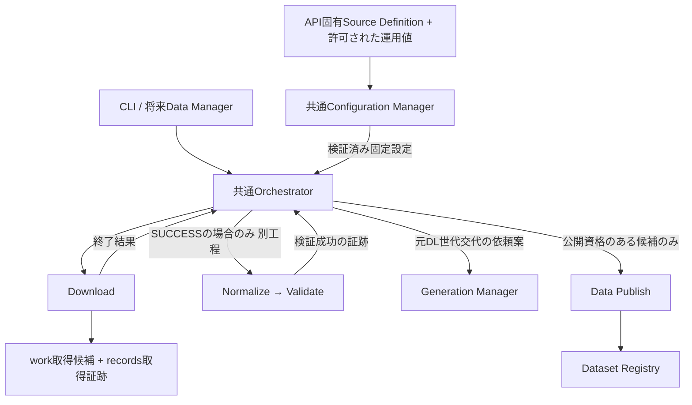

# HereRisk Phase 1-A Download / Acquisition Record実装契約案 v0.1

Task ID: `phase1a-elevation-download-contract-v0.1`
作成日: 2026-10-17 / 作成: Codex / Status: Draft・OWNER承認待ち
確認基準: main `680e2eadcefd0717a4b7bc21f681178c2b6f0471`

## 1. 決定状態と範囲

**FIXED** は今回のOWNER指示・既存契約の継承事項、**PROVISIONAL** は本書の具体案、**UNDECIDED** は採否・方式が未決定の事項を示す。第3節以降の追加仕様・数値・JSON構造は、明記したFIXED以外すべてPROVISIONALであり、実行許可ではない。

FIXED: 国土地理院の標高PNGを事前取得し、ローカルで検証・公開して利用する。利用者要求ごとの外部標高API呼出しは採用しない。47都道府県の設定構造を維持し、初期対象は東京都のみ。API別領域、共通Configuration Manager / Orchestrator、取得定義・実績・公開Registryの分離、元DL原則3世代を維持する。Downloadは後続を直接起動せず、失敗で旧データを破壊しない。

今回の成果物は契約案のみ。Download、CLI、Generation、Restoreを実装しない。MVP 0のFrontend・標高API等の範囲を変更せず、住所・他ハザード・管理画面を追加しない。

## 2. 参照と現状

- [Charter](../project-charter.md)、[基本アーキテクチャ](../architecture/basic-architecture-v0.1.md)
- [データソース定義](../architecture/data-source-definition-v0.1.md)、[Data Publish](../architecture/data-publish-v0.1.md)
- [Dataset Registry](../architecture/dataset-registry-v0.1.md)、[標高API契約](../api/elevation-contract-v0.1.md)
- [AI共通作業規約](../development/ai-development-policy.md)
- [Source Definition](../../api/elevation/conf/sources.json)、[Schema](../../api/elevation/conf/sources.schema.json)
- [API独立性改訂レビュー](../../reviews/phase0/api-isolation-contract-revision-v0.1.md)

現行定義は東京都だけ `targeted=true`、他46道府県はfalse・source_refs空。`gsi-dem10b-candidate` はDEM10B/Z14の候補で、tiles、vertical_reference、pipeline、approval_ref、usageのattribution_text/review_refがnull。構造検証に合格しても**実取得はBLOCKED**。本書で値を補完しない。

公式資料確認日: 2026-10-17。[地理院タイル一覧](https://maps.gsi.go.jp/development/ichiran.html)は取得テンプレート・個別利用条件の確認先、[標高タイル仕様](https://maps.gsi.go.jp/development/demtile.html)は256×256・24bit RGB PNGの根拠。後者はPNGを約100KBと説明するが、最大サイズ保証ではない。公式ページだけを参照し、タイルは取得していない。実配信のContent-Type、応答時間、リダイレクト、レート制限は未確認。ローカル保存・加工・再配布に必要な利用条件の審査は未完了で、リアルタイム表示の条件をそのまま適用しない。

## 3. 責務と呼出し



図のNormalize→ValidateもOrchestratorの逐次呼出しを表し、モジュール間呼出しではない。Phase 1-Aの実装候補はDownloadまでで止める。後段未実装時にValidate成功を捏造せず、元DL世代交代も実行しない。

| 部品 | 入力・責務 | 出力・禁止事項 |
|---|---|---|
| Configuration Manager | 識別子から共通/API設定を発見、型・範囲・権限・承認を確認し固定 | 秘密を含まない実効設定とhash。API独自ローダーを作らない |
| Orchestrator | 対象認可、run_id生成、排他、順序、結果集約 | Download依頼と実行記録。異常時は後続停止 |
| Download | 固定設定からURLを組み立て、転送・保存・取得記録を確定 | 不変の候補参照。current、archive、rel、Registryを変更しない |
| Normalize / Validate | 候補のhashを再確認し変換・品質検証 | 別の処理証跡。取得Recordを更新しない |
| Generation Manager | 認可された元DL単位の交代・圧縮・保持・整理 | 世代manifest・交代記録。公開確定をしない |
| Restore Manager | 原本とメタデータを展開・検証 | 復元候補。currentやRegistryを独断で切り替えない |
| Data Publish | 公開資格を検証し原子的に公開 | Registryの唯一の更新主体。取得実績の履歴ストアにしない |

設定3階層は責務別デフォルト→許可された永続運用変更値→許可された要求値。今回の管理要求は対象識別のみで、URL・パス・コマンド・安全上限の任意上書きを受けない。一般公開APIには取得実行権限を与えない。実行中の設定変更は次回から反映し、同一runの固定値を変更しない。永続ストア方式は未決定。

## 4. Download Input / Output

### 4.1 Input案

| フィールド | 型・制約 |
|---|---|
| api_id | string、認可された既知ID。この部品ではelevation |
| region_codes | string配列、01～47、空・重複禁止。管理地域でありCoverageではない |
| source_ref | string、解決済みsourcesの既存キー。各指定地域のsource_refsに含まれること |
| run_id | Orchestrator生成UUID文字列。同じ実行の全工程で共有 |
| effective_configuration_ref / sha256 | 不変スナップショットの内部識別子と64桁小文字hex。Managerが解決したオブジェクトを渡し、利用者指定パスを開かない |
| authorization_ref | 対象API・source・操作download・承認済み条件を検証できる内部承認識別子。認証トークンは記録しない |

全キー必須・null不可・未知キー拒否。CLIから受け取るのはapi/region/sourceだけ。run_id、設定参照、承認コンテキストは共通管理処理が生成する。対象地域が一つでも未設定なら要求全体をBLOCKEDにし、暗黙に対象を削らない。全国走査モードを将来作る場合は未設定地域を計画時に除外し、Downloadを呼ばない。

固定設定はSource原文、版、source_ref、選択されたsource内容、地域、承認済み安全ポリシー・その版を保持。原文は秘密を含まない定義ファイルのUTF-8バイト列、実効設定は保存したJSONバイト列そのものをhash化し、後から再シリアライズして比較しない。envの秘密・物理保存先はスナップショットへ混入させない。

事前条件: Schema合格に加え、47地域整合、参照先存在、非空タイル集合、0≤X,Y<2^Z、提供元のZ範囲、重複タイルなし、pipeline実装版一致、鉛直基準・利用条件・実行承認の確認、安全ポリシー承認。source別名が同じ取得対象を重複指定する場合は初版では拒否。地域コード13を処理本体に特別扱いする分岐を作らない。

### 4.2 結果案

| キー | 型・規則 |
|---|---|
| run_id / module | string必須。moduleはdownload |
| status | SUCCESS / FAILED / BLOCKED |
| artifacts | 配列必須。各要素はartifact_id、acquisition_id、record_ref（内部相対参照）、sha256、size_bytes。null不可 |
| error_code | SUCCESSのみnull。異常時は下表の非空string |
| message | 安全な固定文言string必須。例外文字列・URL・秘密・物理パスを埋め込まない |

SUCCESSは要求した全タイルの転送と取得Record・確定マーカーが完了した場合のみ。途中までの成功はFAILEDで、確定済みの要素だけartifactsに残す。候補をNormalizeへ渡すのは要求全体SUCCESSの場合のみ。BLOCKEDは前提不足で転送開始なし、artifactsは空。FAILEDは入力不正または実行失敗を表す。公開APIのstatusやHTTP応答とは別契約。

| 状態 | CLI終了コード案 | error_code例 |
|---|---|---|
| SUCCESS | 0 | null |
| BLOCKED | 3 | TARGET_UNCONFIGURED / APPROVAL_REQUIRED / TARGET_BUSY / RECOVERY_REQUIRED |
| FAILED: 入力・設定不正 | 2 | INVALID_INPUT / INVALID_CONFIGURATION |
| FAILED: HTTP・通信 | 10 | HTTP_404 / HTTP_403 / HTTP_429 / HTTP_5XX / HTTP_UNEXPECTED / TIMEOUT / TRANSFER_INTERRUPTED / REDIRECT_REJECTED / TLS_FAILED |
| FAILED: 表現不正 | 11 | CONTENT_TYPE_INVALID / SIZE_INVALID / PNG_INVALID |
| FAILED: 保存・hash | 12 | STORAGE_FULL / PERMISSION_DENIED / HASH_FAILED / STORAGE_INTEGRITY_FAILED |
| FAILED: 記録確定 | 13 | RECORD_COMMIT_FAILED |
| FAILED: その他 | 14 | INTERNAL_ERROR |

ライブラリは構造化結果を返しprocess exitしない。CLIが1行JSONをstdout、共通ログを別経路へ出して終了コードへ対応付ける。強制終了時はJSONが返らないことがある。監督側は「結果不明」として回復確認し、SUCCESSを推定しない。

次のJSONはすべて架空の契約例であり、実取得・承認の証拠ではない。hashは形状を示すダミーで実ファイルと照合できない。

```json
{"run_id":"11111111-1111-4111-8111-111111111111","module":"download","status":"SUCCESS","artifacts":[{"artifact_id":"22222222-2222-4222-8222-222222222222","acquisition_id":"22222222-2222-4222-8222-222222222222","record_ref":"acquisitions/11111111-1111-4111-8111-111111111111/22222222-2222-4222-8222-222222222222.json","sha256":"aaaaaaaaaaaaaaaaaaaaaaaaaaaaaaaaaaaaaaaaaaaaaaaaaaaaaaaaaaaaaaaa","size_bytes":100000}],"error_code":null,"message":"Acquisition committed"}
```

```json
{"run_id":"11111111-1111-4111-8111-111111111111","module":"download","status":"BLOCKED","artifacts":[],"error_code":"APPROVAL_REQUIRED","message":"Required acquisition approvals are missing"}
```

```json
{"run_id":"11111111-1111-4111-8111-111111111111","module":"download","status":"FAILED","artifacts":[],"error_code":"RECORD_COMMIT_FAILED","message":"Acquisition record could not be committed"}
```

Normalizeへの引渡しは、この内部参照と固定設定参照を使う。任意パスを受けず、確定マーカー・Record・原本hashを照合して読取専用で開く。Downloadは標高値の品質や公開資格を保証しない。

## 5. Acquisition Record契約案

1ファイルにつき1Record。IDはDownloadが採番するUUID、artifact_idは初版ではacquisition_idと同値。保存先候補は `/data/elevation/records/acquisitions/<run_id>/<acquisition_id>.json`。全表のキーを必須とし、明記以外null不可。未知キー拒否、日時はUTC RFC3339文字列、hashは64桁小文字hex。

| キー | 型・制約 |
|---|---|
| record_schema_version | string、0.1 |
| acquisition_id / run_id / api_id | string、UUID / UUID / elevation |
| provider | object、id/nameとも非空string |
| data_name / data_type | string、取得定義の名称 / elevation_png |
| requested_url / effective_url | string、認可済みHTTPS URL。実要求・実受信先。転送なしでは同値 |
| official_page_url | string、公式案内HTTPS URL |
| acquired_at | string、応答本体を完全受信した時刻。要求開始・設定更新時刻ではない |
| management_prefectures | 01～47のstring配列、非空・重複なし。Coverageの代用禁止 |
| tile | object、z/x/yは整数。承認済み集合内 |
| size_bytes / sha256 | 正整数 / string。保存原本から再読して算出・照合 |
| source_definition | object、schema_version、definition_revision、source_ref、raw_sha256すべてstring |
| effective_configuration | object、snapshot_ref（records配下相対参照）、sha256。秘密なしの不変バイト列を指す |
| pipeline | object、id/version非空string。実行実装の版と一致 |
| original_version | stringまたはnull。確認できた提供元の版だけ |
| data_reference_date | YYYY-MM-DD stringまたはnull。意味と根拠不明ならnull |
| source_metadata_evidence | HTTPS URL stringまたはnull。元データ版・基準日のいずれか非nullなら必須非null。取得時刻から推測しない |
| usage_snapshot | object、terms_url、attribution_text、review_ref、approval_refは非空string。承認した利用条件・出典を固定 |

URLのuserinfo、秘密query、任意fragmentを禁止。初期テンプレートはqueryなし。実取得URLとタイルは必要な管理証跡であり、利用者の詳細位置ではない。Recordは非公開管理領域に置き、ログ・公開APIへ転記しない。

```json
{
  "record_schema_version": "0.1",
  "acquisition_id": "22222222-2222-4222-8222-222222222222",
  "run_id": "11111111-1111-4111-8111-111111111111",
  "api_id": "elevation",
  "provider": {"id": "gsi", "name": "国土地理院"},
  "data_name": "標高PNGタイル（契約例）",
  "data_type": "elevation_png",
  "requested_url": "https://cyberjapandata.gsi.go.jp/xyz/dem_png/14/14547/6463.png",
  "effective_url": "https://cyberjapandata.gsi.go.jp/xyz/dem_png/14/14547/6463.png",
  "official_page_url": "https://maps.gsi.go.jp/development/ichiran.html",
  "acquired_at": "2026-10-17T00:00:00Z",
  "management_prefectures": ["13"],
  "tile": {"z": 14, "x": 14547, "y": 6463},
  "size_bytes": 100000,
  "sha256": "aaaaaaaaaaaaaaaaaaaaaaaaaaaaaaaaaaaaaaaaaaaaaaaaaaaaaaaaaaaaaaaa",
  "source_definition": {
    "schema_version": "0.1", "definition_revision": "fixture-approved-1",
    "source_ref": "gsi-dem10b-candidate",
    "raw_sha256": "bbbbbbbbbbbbbbbbbbbbbbbbbbbbbbbbbbbbbbbbbbbbbbbbbbbbbbbbbbbbbbbb"
  },
  "effective_configuration": {
    "snapshot_ref": "configurations/11111111-1111-4111-8111-111111111111/effective.json",
    "sha256": "cccccccccccccccccccccccccccccccccccccccccccccccccccccccccccccccc"
  },
  "pipeline": {"id": "elevation-download", "version": "fixture-0.1"},
  "original_version": null,
  "data_reference_date": null,
  "source_metadata_evidence": null,
  "usage_snapshot": {
    "terms_url": "https://www.gsi.go.jp/kikakuchousei/kikakuchousei40182.html",
    "attribution_text": "出典：国土地理院（契約例）",
    "review_ref": "fixture-terms-review", "approval_ref": "fixture-owner-approval"
  }
}
```

このZ/X/Y、時刻、版、承認識別子は取得対象の決定ではない。実在テンプレートの形を示すだけで、該当PNGの存在・内容を確認していない。

原文定義は同じrunの `records/configurations/<run_id>/source.json` に不変保存。上のsnapshot_refは実効設定の不変保存先。訂正は `records/corrections/<correction_id>.json` に対象acquisition_id、訂正理由、訂正者、日時、訂正内容を追記する案。原Recordを置換しない。原本の差替えは新acquisition_idによる再取得が必要。消費側は未解決の訂正がある候補をBLOCKEDにし、再検証・承認を経る。

Validate証跡はacquisition_id・入力hash・正規化成果物hash・profile・結果・時刻を参照。Publish証跡はそれらとdataset_id/publication.versionを結ぶ。Registryには既存契約のsource/acquisition/pipeline/validation/publicationだけを写し、Record全体や設定・履歴を追加しない。`xyz_png`はアダプター識別でありRegistryのacquisition.method列挙値に無断追加しない。世代アーカイブには原本、Record、原文・実効設定、対応する処理証跡とmanifestを含め、後日のPublish証跡は別の不変記録として関連付ける。

## 6. 保存・確定・回復・権限

| 領域案 | 所有・操作 |
|---|---|
| work/download/<run_id>/<acquisition_id>/original.part | Downloadだけが作成。受信中。公開APIアクセス不可 |
| work/acquisitions/<run_id>/<acquisition_id>/original.png | 完全受信候補。不変化後はNormalize等が参照を固定して読む |
| records/configurations、acquisitions、commits | 管理処理のみ。Downloadは新規作成のみ。既存記録上書き禁止 |
| dl/current/<retention_key>/<generation_id>、dl/archive/<retention_key>/ | Generationだけが交代・圧縮・整理。Downloadは書込み不可 |
| rel/versions、Registry | Download書込み不可。公開APIは公開Registryの指す自APIの実体だけ読取 |

物理rootはenvで解決。管理対象のパス部品は検証済みIDから内部生成し、`..`・絶対パス・symlinkによる領域外脱出を拒否する。共有処理も許可されたAPI・操作のみ。OS権限の具体化、Mac/VPSの永続化保証、Volume・UID/GIDはUNDECIDEDで、実装時に検証する。

確定手順案:

1. Orchestratorが `(api_id, source_ref)` の排他を取得。全タイル集合・認可・容量見積りを確認し、固定設定と原文を新規保存。初版は同じsourceの同時実行を禁止し、待機せずTARGET_BUSY。別名同一取得先は設定検証で拒否する。
2. `.part`へ逐次書込み、転送中もサイズ上限を監視。完全受信・PNG転送検査後、flush・永続化を行い、保存ファイルを再読して受信時hash/sizeと照合する。
3. 同じファイルシステム内のrenameで不変候補へ確定。destination存在なら上書きせず照合または回復へ送る。work内のrename前提を環境検証し、別FSへのrenameを原子的と仮定しない。
4. Recordをrecords内の一時名へ書き、永続化して最終名へrename。最後に `records/commits/<acquisition_id>.json` を同様に確定する。このマーカーにはschema_version、acquisition_id、record_ref、record_sha256、artifact_ref（work配下相対参照）、artifact_sha256を記録する。
5. マーカー・Record・原本の対応が読める場合だけ、そのファイルの取得成功とする。必要なファイルと親ディレクトリの永続化が完了してから結果を返す。workとrecords全体を一回のrenameで原子的更新できるとは主張しない。

マーカーなしの候補やRecordは消費不可。マーカー作成後に応答を失った場合は同じrun_id・対象・設定hashで確定物を照合し、再取得せず既存結果を返す。同一run_idで設定が異なる再実行は拒否。確定物の欠損・hash不整合はRECOVERY_REQUIREDとして隔離し、上書きしない。

SIGKILL等で結果がない場合、再起動時は管理回復処理が排他・実行者不在を確認して調査する。マーカーなしでも原本・Record・設定が完全なら同じ内容を確認して確定を完了できる案。証拠不足なら候補を隔離し新runで再実行する。部分ファイルは参照がなく所有runの終了確認後のみ削除可能。PIDだけでロックを奪わず、初版は単一ホストのプロセス寿命に結びつく排他を候補とする。複数ホスト共有ストレージは初版対象外・方式未決定。

Record書込失敗はFAILEDであり、原本受信だけではSUCCESSにならない。容量不足時は停止し、旧世代を空き容量確保のために先行削除しない。完全候補・部分候補の保持期限と容量上限は未決定で、無制限の自動再実行は許可しない。

## 7. ネットワーク・異常時ポリシー案

次は承認待ちの初期候補。現行sources Schemaにキーを追加しない。共通ポリシー定義と許可されたAPI固有設定の配置・Schema改訂は後続承認が必要。未承認のままコード内デフォルトで実行可能にしない。

| 項目 | 候補・理由 |
|---|---|
| 接続先 | HTTPS、host完全一致cyberjapandata.gsi.go.jp、port443、既存dem_pngテンプレート。固定Z/X/Y整数だけ展開。任意URL/コマンド禁止 |
| TLS | 証明書・ホスト検証必須、失敗時停止。無効化オプションなし |
| DNS/プロキシ | loopback・private・link-local等の内部接続を拒否し、接続時にも検査。任意環境プロキシを自動採用しない。承認済み経路だけ使用 |
| redirect | 初版0回。3xxを失敗にして転送先へ接続しない。必要なら許可先・回数を再承認 |
| body | status200のみ。Content-Typeのメディア型image/png必須、missingも拒否。Content-Encodingはidentityのみ。最大1MiB/タイル、空body拒否 |
| 転送検査 | Content-Lengthがあれば一致、PNG signature・IHDR寸法/色形式・chunk境界/CRC/IEND・末尾余分データを検査。256×256・24bit RGB想定。値の標高品質・CoverageはValidateの責務 |
| 時間 | connect5秒、無受信10秒、タイル全体30秒候補。応答ヘッダー・本文を含む上限。実配信性能の保証値ではない |
| 負荷 | 初版逐次取得、開始間隔1秒以上、最大16タイル/要求候補。限定検証の暴走防止で、提供元公称制限ではない |
| 再試行 | 初版自動0回。429/5xx/timeoutでも停止。再実行は新しい認可要求で実施。将来Retry-After・backoff・回数上限を承認して追加 |

1MiBは仕様ページの概算に余裕を持たせた提案で、正規PNGが必ず収まるとの保証ではない。PNGコンテナ破損の検査と、標高値の品質・鉛直基準・公開資格の検査を分離する。

| 異常 | 処理と旧データ保護 |
|---|---|
| 未設定地域・tiles/null・承認/利用条件未確認 | BLOCKED、ネットワーク0回、Recordなし |
| JSON/Schema不正、未知source、範囲不正 | FAILED/INVALID_CONFIGURATION、ネットワーク0回 |
| 404 / 403 / 429 / 5xx | 対応HTTPエラーでFAILED。404を有効な空PNGやno_data公開へ変換しない |
| timeout・途中切断・長さ不一致 | FAILED、未完了分は.part隔離。正常Recordを作らない |
| redirect・TLS・MIME・サイズ・PNG不正 | FAILED、後続・世代交代なし |
| SHA算出/再読不一致、容量、権限 | FAILED、current/archive保持、確定済み他タイルは不変 |
| 二重起動 | 後発BLOCKED、既存処理を停止させない |
| Record/マーカー書込失敗 | FAILED/RECORD_COMMIT_FAILED、回復確認まで候補消費不可 |
| プロセス停止 | 結果不明を監督記録。確定マーカーを照合して回復、未確認の成功扱い禁止 |

## 8. 元DLの世代交代

| 案 | 利点 | 欠点・推奨 |
|---|---|---|
| Download直後にGenerationへ交代依頼 | 取得した最新原本を直ちにcurrent化 | Normalize/Validate失敗でも最後の利用可能原本がcurrentから外れる。不採用推奨 |
| Normalize成功後 | 読める原本に限定 | 品質未検証のcurrent化が残る |
| Validate成功後にOrchestratorからGenerationへ依頼 | 最後の検証済み原本を保護 | Download単独では候補保持が必要。**推奨**、OWNER採否待ち |

DownloadのSUCCESSは取得事実として保持し、後の失敗で書き換えない。Phase 1-Aではwork候補とrecordsまで。raw currentは公開currentではない。Generation失敗時はその管理工程をFAILEDとして後続を停止する案とし、Downloadを失敗に改変しない。公開後の世代整理失敗は既存契約どおり公開成功と別結果で報告する。

保持単位はデータセット相当の `retention_key` を基本候補とする。公開単位が未決定なので、API全体・都道府県・source_refを自動的にDataset IDとみなさない。承認された原本集合から安定キーを割り当てる方式が決まるまで交代はBLOCKED。取得地域とCoverageは独立し、島嶼・県境・複数地域の原本も同じ仕組みで参照する。

Generationの安全な交代案: 対象キーを排他→新世代を不変ディレクトリへコピーし照合→旧currentの圧縮と復元検査→世代manifestと交代記録を永続化→小さな現行参照ファイルを原子的に更新→使用中参照の終了後に旧非圧縮複製と最古世代を整理。途中でwork候補を移動してNormalizeの参照を壊さない。現行参照は元DLの管理用であり、公開Registryの代用ではない。バックアップ復元時にも同じ参照とmanifestの整合を確認する。

manifestはgeneration_id、retention_key、全原本の相対名/size/hash/acquisition_id、同梱メタデータの相対名/hash、作成時刻、検証証跡参照を持つ案。archive単体から原本と対応メタデータを復元できること。圧縮方式・current参照形式・fsync保証・バックアップ媒体は未決定。

`C=n`を非圧縮current、`A=[...]`を圧縮過去世代、`W=n`を完全取得候補とする。

| ケース | 状態遷移案・期待結果 |
|---|---|
| 1 初回Download成功 | Cなし→W1。Validate成功・交代成功後にC1、A空 |
| 2 二回目Download成功 | C1→C1+W2。Validate後、A1の検査成功→C2/A[1] |
| 3 四回目成功 | C3/A[2,1]+W4→検証・交代後C4/A[3,2,1]→参照・復旧安全確認後A[3,2] |
| 4 Download途中失敗 | C/A不変、部分候補隔離。取得成功Recordを捏造しない |
| 5 Download成功・Normalize失敗 | WとRecord保持、C/A不変。新runで調査・再処理 |
| 6 Validate失敗 | 同上。未検証/不合格候補をcurrent化しない |
| 7 圧縮失敗 | 現行参照更新前に停止。旧C/AとWを保持。再開時に一時archiveを照合 |
| 8 容量不足 | 更新前は旧C/A維持。更新後の整理失敗は新Cと旧複製を保持し別エラー。先行削除禁止 |
| 9 Restore必要 | Restoreがarchiveとhash/metadataを検証しwork復元候補作成。承認・再検証後Generationへ交代依頼。公開再確定は必ずData Publish |

整理失敗・使用中保護で一時的に3世代を超えることを許容する案。3世代厳守のために復元可能性を破壊しない。共通保持数デフォルト3、許可されたAPIスコープの運用変更のみ候補とし、一般API上書きは禁止。変更可能範囲・最小保持数は未決定。公開世代と元DL世代の削除を連動させず、どちらからも参照される証跡は保持する。

## 9. CLI・ログ・共通実行原則

概念例（実行可能コマンドではない）: `pipeline download --api elevation --region 13 --source gsi-dem10b-candidate`。CLIと将来Data Managerは同じOrchestratorのdownload操作へ依頼する。Download単体の管理専用入口を利用し、一般公開APIから到達させない。

既存Pipeline Execution Contractの8原則を継承する:

1. 各モジュールは終了ステータスを明示する。
2. SUCCESSの場合のみOrchestratorが次へ進める。
3. 異常時は後続を止め、エラーを記録する。
4. 統一構造化ログを出す。
5. syslogで集約・確認できる。
6. run_idで結果とログを関連付ける。
7. モジュールは後続モジュールを直接呼ばない。
8. 公開後の世代管理失敗は公開結果と分けて報告する。

INFOは開始/確定、WARNINGは前提不足/競合、ERRORは実行失敗。最小ログ項目案はtimestamp、level、module、api_id、run_id、error_code、固定message。利用者位置、認証情報、秘密、応答body、完全URL、設定全体、内部例外を出さない。Recordは必要な公開取得URLを保持するが秘密を受け入れない。公開API request_idとpipeline run_idを共用しない。syslog/journaldへ到達しjournalctlで追跡できることは実装後の運用受入条件で、今回未検証。

## 10. 実装時の受入試験仕様（すべてNOT RUN）

外部通信なしのfixtureでは、固定時計・ID発行器・HTTP輸送・保存層を差し替え、PNG原本の既知バイト列とhashを用意する。GSIホストへの接続を禁止する。fixtureの承認識別子を本番認可として受け入れない。正常fixture設定を別地域へ変える試験は本番47地域設定を書き換えない。

| ID | 入力・障害注入 | 期待結果 |
|---|---|---|
| F01 | 現行SourceとSchema | 47コード/名称一致、13だけtargeted。他46はfalse/空。構造合格、実行BLOCKED、HTTP0回 |
| F02 | 01を指定／13と01を混在 | TARGET_UNCONFIGURED、成果物0、後続0 |
| F03 | 承認済み別地域fixture | 同じ解決処理でSUCCESS。13専用条件分岐なし |
| F04 | JSON破損、未知キー、重複コード、参照欠落、XY範囲外 | INVALID_CONFIGURATION、HTTP0回、Registry/current不変。JSONパーサーで重複キーを拒否 |
| F05 | tiles/承認/利用条件/pipelineの欠落 | BLOCKED、取得Record0、補完なし |
| F06 | 正常PNG固定body | 保存byte同一、size=len(body)、sha256一致、Record/マーカー対応、SUCCESS/exit0 |
| F07 | 正常・負値・欠損画素を含む正常PNG | 転送としてSUCCESS。品質合格や公開を宣言しない |
| F08 | 404,403,429,500,204,302,TLS失敗 | 対応エラー、再試行0、redirect先接続0、次工程0 |
| F09 | connect/無受信/全体timeout、途中切断、Content-Length不一致 | FAILED、部分候補消費不可、旧current/archive byte/hash不変 |
| F10 | MIME欠落/不正、0byte、上限+1、壊れたPNG | FAILED、Recordなし、サイズ超過時に受信打切り |
| F11 | hash失敗、再読不一致、disk full、permission失敗 | 対応保存エラー、旧世代不変。Record書込/マーカー失敗はexit13 |
| F12 | part書込後/原本rename後/Record確定後/マーカー後で強制停止 | 未確定は消費不可。確定後は照合で同じ取得を再利用。再実行で旧記録上書きなし |
| F13 | 同じsource同時実行 | 片方のみ転送、後発TARGET_BUSY。停止後は回復確認してロック再取得 |
| F14 | 2タイル中2番目失敗 | FAILED、先行確定Recordのみartifactsに残る、Normalize0回 |
| F15 | Source版/URL更新して新run | 旧Record・snapshot hash不変。実URL/時刻/設定版を新旧別々に追跡 |
| F16 | SUCCESS、各失敗をspyで確認 | DownloadからNormalize/Validate/Publish呼出し0、Registry書込0、dl書込0 |
| F17 | 他API ID、path traversal、symlink、秘密付きURL | 認可/設定段階で拒否、領域外書込0、秘密がログ/Recordにない |
| F18 | 同じrun/config再要求／異なるconfig再要求 | 前者は確定結果再利用でHTTP0、後者は拒否。欠損確定物はRECOVERY_REQUIRED |
| F19 | source別名で同一URL集合 | 設定拒否。重複取得・競合世代を作らない |
| F20 | 第8節の9ケースと交代途中の各停止点 | Generationの後続工程試験。参照先は完整な旧/新のどちらか、archive復元可能、使用中削除0 |
| F21 | Record訂正・Validate/Publish証跡 | 原Record不変、取得→検証→公開版の追跡可能。未解決訂正は利用停止 |
| F22 | 構造化ログ収集 | run_idで結果と対応、秘密/利用者位置なし。stdout JSONと分離 |

F20はGeneration未実装のPhase 1-A単体テストのPASS条件に混ぜず、後続実装の受入仕様として保持する。初段はGenerationを呼ばずcurrent不変を検証する。

実GSI統合試験（別枠、NOT RUN）: OWNERがタイル集合・利用条件・安全上限を承認後、限定PNGのHTTP/MIME/サイズ/時間/保存hash/Record追跡を確認する。実配信と候補ポリシーが合わなければ契約を改訂し、検査を暗黙に緩めない。実機の停止/復旧・権限・syslog/journald試験も別途必要。今回実施するのは文書・JSON例・既存設定の静的確認のみ。

## 11. 整合性・実装前のOWNER判断

| 項目 | 状態・判断事項 |
|---|---|
| 取得方式 | FIXED: GSI PNG事前取得。既存標高API契約O01の方式全体「未決定」は今回指示より古い記述。既存文書は変更せずレビューへ記録 |
| データ候補 | UNDECIDED: DEM10B/Z14、具体タイル、鉛直基準、利用条件/出典、pipeline実装版・実行承認。決定まで実取得不可 |
| 入出力・Record | PROVISIONAL: 型、ID、終了コード、確定マーカー、snapshot、訂正方式の採用。追加Schemaを作る場合は別途承認 |
| ネットワーク | UNDECIDED: 第7節の上限/拒否/再試行案と設定配置・Schema改訂。既存Schemaは新規ポリシーキーを許容しない |
| current交代 | PROVISIONAL: Validate成功後、Generationが実施。Phase 1-A単独では候補まで。採否を承認する |
| 保持単位・公開単位 | UNDECIDED: retention_keyとDatasetの対応、複数地域/複数sourceの集合。1PNG=1Datasetを確定しない |
| 保存・回復 | UNDECIDED: ファイル永続化保証、排他機構、物理FS、候補保持期限、容量枠、圧縮/backup/restore方式 |
| 公開契約 | FIXED継承: Registryの公開資格、Publishだけの原子的切替、Generation/Restore責務、既存API応答は変更なし |

実装開始には少なくともInput/Output・Record・確定/排他の案と試験範囲の承認が必要。fixtureのみの実装承認と、実データ取得の承認を分ける。全GenerationやData Managerの実装をPhase 1-Aに要求しない。
