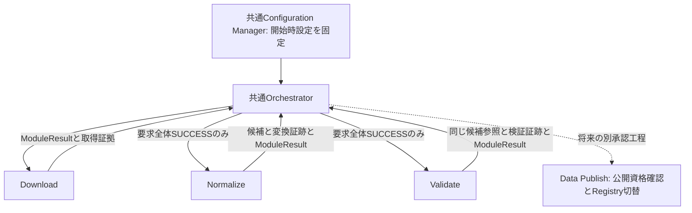

# HereRisk Elevation Normalize / Validate 最小契約案 v0.1

- Task ID: `phase1b0-elevation-normalize-validate-contract`
- 作成: Codex（設計） / 日付: 2026-10-17
- 基準コミット: `b783025173ee24befa28e37c30c8069a135915e8`
- Status: Draft / OWNER承認待ち。文書のみ。実装・動作検証・公開承認ではない。

## 1. 確定度・適用範囲

**FIXED** は今回指示および既存契約から継承する責務・禁止事項、**PROVISIONAL** は今回の具体案、**UNDECIDED** は後続判断事項。第3～9節の追加の形式・数値・配置・分類はすべてPROVISIONALであり、既存実装として記述しない。公式仕様の確認事実はHereRisk独自案の承認とは別である。

FIXED: Phase 1-Bはfixture限定。実GSI取得、公開、Generation、Restore、管理画面、DBを追加しない。Normalizeは変換、Validateは品質・整合性の受入判定を行い、互いを起動しない。Download原本・Acquisition Record・固定設定は変更しない。Registry・dl・relを変更しない。共通設定解決、保存、ログ、結果契約を再利用し、東京専用分岐や別の汎用パイプライン基盤を作らない。欠損を0mにしない。

参照:

- [基本アーキテクチャ](../architecture/basic-architecture-v0.1.md)
- [Download契約](elevation-download-contract-v0.1.md)
- [標高API契約](../api/elevation-contract-v0.1.md)
- [Data Publish](../architecture/data-publish-v0.1.md)、[Dataset Registry](../architecture/dataset-registry-v0.1.md)
- [AI共通作業規約](../development/ai-development-policy.md)
- [Round 2最終受入](../../reviews/phase1/phase1a1-final-acceptance-r2.md)
- [Download実装](../../src/hererisk/elevation/download/download.py)、[PNG転送検査](../../src/hererisk/elevation/download/png.py)
- [共通保存層](../../src/hererisk/common/storage.py)、[Orchestrator](../../src/hererisk/common/orchestrator.py)、[結果型](../../src/hererisk/common/result.py)、[設定管理](../../src/hererisk/common/config.py)、[認可](../../src/hererisk/common/authorization.py)

## 2. 公式仕様と設計判断の境界

国土地理院の[標高タイル詳細仕様](https://maps.gsi.go.jp/development/demtile.html)を2026-10-17に確認。公式説明ページのみ参照し、PNG・実データは取得・保存していない。

確認事実: 256×256の24bit RGB PNG。整数 `q = 65536*R + 256*G + B` に対し、qが8388608未満なら標高はq/100 m、等しければ欠損、それより大きければ(q−16777216)/100 m。欠損画素はRGB=(128,0,0)。タイルの画素は東へX、南へY。

HereRiskの変換案: 上記式を整数cmで保持し、欠損をJSON nullにする。0.01mは符号化単位であり、1cmの測量精度を保証しない。整数の表現可能範囲は実地形の妥当性範囲ではない。

鉛直基準、採用版の改定反映、元データの基準日・精度、実タイルの有効範囲は、この符号化仕様から確定しない。固定設定に記録された情報を出典と結び付けて継承し、不明値を補完しない。fixtureの鉛直基準ラベルは架空試験用であり、T.P.等の実基準の承認とみなさない。DEM10B/Z14の最終採否・実取得条件も本書では確定しない。

## 3. 処理境界とDownload接続

呼出し単位は既存Downloadと同じ1 run・1 source_ref・固定された全タイル集合。run_idを同一パイプラインで継承する。管理地域は管理用属性でありCoverageではない。タイルを黙って省略したり別のsourceで穴埋めしない。

| モジュール | 入力 | 責務・出力 | 行わないこと |
|---|---|---|---|
| Orchestrator | 認可済み管理要求、固定設定、各結果 | 共通認可・排他・順序制御、全体成功の確認、結果返却 | RGBの変換・品質判定 |
| Normalize | SUCCESSのDownload結果、DownloadPlan相当の固定設定、認可済み保存領域 | 入力証拠を照合しPNGを復号、タイルごとの候補とrun単位の変換証跡を確定 | データ補正、地形品質保証、Validateの起動 |
| Validate | SUCCESSのNormalize結果、同じ固定設定、変換証跡 | 候補の形式・由来・件数・欠損状態を検査、同じ候補に検証証跡を付けて返す | 再変換・修復・再サンプリング、候補の書換え、Publishの起動 |

Normalize入力の前提:

1. module=download、status=SUCCESS、run_idとapi_id=elevationが固定計画と一致する。結果オブジェクトだけを成功の証明としない。
2. 既存の `reconcile_run` / `verify_commit` を再利用し、marker・Record・原本集合と設定上の全Z/X/Y集合が完全一致することを確認する。部分成功、重複、余分な取得物、未確定物、他run混入を拒否する。
3. `records/configurations/<run_id>/source.json` の原文hashと `effective.json` の保存バイト列hash、Recordの参照、固定計画を照合する。後から読み直した最新設定で代替しない。既存Orchestratorのsnapshot照合責務を共通入口で再利用し、Normalize独自の設定ローダーを作らない。
4. provider、URL、pipeline、地域、タイル、取得日時を既存検査で固定計画へ照合する。Record/markerのhashだけ一致させた改変を受け入れない。
5. 復号する原本は保存層から上限付きで読み、その**同じバイト列**のsize/hashを照合して復号する。検査後に別パスから無制限に開き直さない。

既存 `reconcile_run` は整合する部分集合を返し得るため、全計画との集合一致は呼出側の必須条件とする。Downloadの `execute` やtransportを後段の入力検査として呼ばない。読取検査ヘルパーへの同一API内依存は許容し、commonからelevationの内部実装へ依存を逆転させない。

単独テストでは検証済みの固定入力を注入できる。管理入口からの実行では上記前提検査を省略しない。別プロセスで保存済み入力を再開する方式は後続判断とし、初版は同一管理実行の受渡しを基本案とする。

## 4. Normalizeの最小表現

### 4.1 二案比較・推奨

| 方式 | 単純さ・実装量 | 将来利用・制約 |
|---|---|---|
| A: JSON、整数cmまたはnullの固定長配列（推奨） | 標準JSONで読め、エンディアン・NaN・別maskファイルが不要。数値の損失なし | fixtureや少数タイルの監査が容易。解析時のオブジェクト量・ファイルサイズは大きく、全国本番形式とは確定しない |
| B: int32バイナリ＋欠損mask＋メタデータ | 配列は小さく、直接アクセスしやすい。バイト順、mask bit順、複数実体の確定契約が増える | 大量処理に向くが、初版の実装・検証量が増える。正式公開形式を決める工程で再比較 |

AをPhase 1-Bの内部候補に推奨する。原PNGも保存し、将来の形式変更で取得元へ再接続する前提を置かない。JSONを公開APIのwire形式や公開データ形式に自動採用しない。

### 4.2 候補JSON v0.1案

1取得タイルに1候補。全キー必須、未知キー・重複キー拒否。明記した配列要素以外null不可。候補はUTF-8 JSONで保存し、ファイル全体の保存バイト列をSHA-256の対象とする。

| キー | 型・値 |
|---|---|
| format | string、`hererisk-elevation-cm-json-v0.1` |
| tile | object、z/x/yは整数（boolean不可）、固定取得対象と一致。0≤x,y<2^z |
| width / height | integer、それぞれ256 |
| values_cm | 長さ65536の配列。各要素は整数−8388607～8388607またはnull。boolean、文字列、小数、NaN、Infinityは拒否 |

並びは北西原点・row-major、`index = pixel_y * 256 + pixel_x`。行反転、転置、補間、穴埋め、色補正、gamma適用、ICC変換、リサイズ、鉛直変換を行わない。RGB各8bitの元サンプルを扱い、PNGを見た目の画像へ変換しない。RGBの任意PLTEがあってもpalette indexとして解釈しない。透明度を欠損の代用にしない。

q=8388608だけをnullへ変換し、q<8388608はq、q>8388608はq−16777216を格納する。メートルへ変換するのは後続消費側の責務。候補には元データ版・URL・設定全文を複製せず、変換証跡からAcquisition Recordへ辿る。

以下は合成画素の期待値であり、実地点の標高ではない。

| RGB | values_cm | 後続での標高m |
|---|---:|---:|
| (0,4,210) | 1234 | 12.34 |
| (0,0,0) | 0 | 0 |
| (255,255,136) | -120 | -1.20 |
| (128,0,0) | null | 欠損 |
| (127,255,255) | 8388607 | 83886.07（符号化境界試験） |
| (128,0,1) | -8388607 | -83886.07（符号化境界試験） |

### 4.3 PNG復号の範囲と上限

Downloadのコンテナ検査は画素展開を行っていない。NormalizeはCRC等の転送検査を再実装せず既存 `check_png` を利用し、復号時のIDAT破損、filter不正、画素不足・超過を追加で拒否する。8bit RGB・256×256以外を自動変換して受け入れない。

PROVISIONAL: 既存Downloadが許容する非interlace/Adam7の両方を扱えるPNGライブラリを薄いアダプターで利用する。デコーダー・依存版の採用はUNDECIDED。独自の汎用PNGデコーダーを作らない。ライブラリの色変換無効化、元RGB取得、厳密な展開終端、読込・展開上限を確認できるものを選ぶ。単にload後に寸法を見るだけでは不足する。

原本は既存 `max_tile_bytes`、タイル数は `max_tiles_per_request` を継承。展開は1タイルずつ、出力RGBは196608 bytes、サンプル数65536に制限する。非interlaceの展開scanlineは196864 bytes、Adam7では196608に各passの総行数480を加え197088 bytesを上限案とする。これはzlib展開データの境界であり、ライブラリの総メモリ保証値ではない。巨大IDATや付随チャンクの展開も制限できるかを実装時に確認する。

候補JSONはcompact出力（不要な空白なし）で1 MiB上限案。候補メタデータは固定キー・小整数のみで、65536件の最長整数表現でもこの上限内に収まる。証跡は各1 MiB、設定・取得Record・markerは既存上限を維持する。開始前に固定タイル集合から証跡サイズを見積もり、上限を満たせない要求はINVALID_CONFIGURATIONで候補作成前に拒否する。上限超過を切り捨てや欠損として成功にしない。全タイルの展開配列を同時保持しない。

## 5. Validateの最小受入profile案

profile ID案: `fixture-elevation-normalized-v0.1`。固定された実装契約として版管理し、新しい設定JSON・しきい値UIは作らない。これはfixtureの構造・変換結果を対象とするprofileで、本番公開資格を保証しない。

| 検査 | 合格条件・意味 |
|---|---|
| Normalize成功 | 全体SUCCESS、確定変換証跡、同run・同設定・同profile・同候補集合。部分成功を受けない |
| 候補の整合性 | 上限付きで読んだ同じbytesのhash/sizeが変換証跡と一致する |
| JSON形式 | 第4節のキー・型・範囲・長さ。重複・非有限・boolean等を暗黙変換しない |
| タイル位置 | z/x/yが取得Recordと固定計画に一致し、タイル重複・欠落・追加なし。地域コード一致だけで判定しない |
| 値・欠損 | 整数cmの表現域内、nullだけ欠損。0と負値を正常値として数える |
| 件数・統計 | valid_count + nodata_count = 65536。min_cm/max_cmは有効値のみから再計算し、全欠損時はともにnull |
| 入力対応 | 入力Record・原本・設定のhash参照が健全で、Download検査が成立。品質証跡が別入力に付け替わっていない |

Normalizeは計算と形式生成に必要な検査、Validateは保存後の候補の受入検査を担う。境界でのhash・形式再確認は意図的な整合確認であり、Validateに二つ目のRGB復号器を実装しない。変換アルゴリズムの正しさは独立した期待値を用いたfixtureテストで担保する。信頼された処理が値と全証跡を同時改竄した状況をhashだけで検出できるとは主張しない。

**欠損方針案:** 一部欠損・全欠損とも、形式と由来が正しければprofile上はSUCCESS。nodata_countを必ず証跡に記録し、全欠損はWARNINGも出す。欠損率を黙って隠さず、全欠損を有効Coverageや「0mのタイル」にしない。本番で全欠損を公開するか、最大欠損率・地形上の許容範囲・近隣との整合を要求するかはUNDECIDED。符号化域内というだけで実地形として正しいとは保証しない。

## 6. 結果・証跡・失敗契約案

### 6.1 ModuleResultと内部参照

既存 `ModuleResult` のrun_id/module/status/error_code/message/artifactsを再利用する。moduleはnormalizeまたはvalidate。SUCCESSはerror_code=null、失敗は登録済みコード、messageは安全な固定文言。既存のsuccessヘルパーの文言はDownload専用のため、後段では共通型のコンストラクターに工程別固定文言を渡す案とする。別の結果基盤を作らない。

既存 `Artifact` の形を維持する提案:

| 項目 | Normalize成功 | Validate成功 |
|---|---|---|
| artifact_id / acquisition_id | 一対一変換のためともに元acquisition_id | 同じID |
| record_ref | records配下のrun単位の変換証跡 | records配下のrun単位の検証証跡 |
| sha256 / size_bytes | 候補JSONのhash/サイズ | 同じ候補JSONのhash/サイズ |

IDの解釈はmodule/run_idとの組で行う。Download ArtifactのhashをPNG以外へ書き換えることはせず、各段階が新しい結果オブジェクトを返す。候補の実体参照は証跡内の `candidate_ref`（work配下）で解決する。Validateは候補をコピーしない。record_refは型名にかかわらず段階別証跡を指すという**追加の意味契約案**であり、既存Download消費側へ後段Artifactを誤入力させない。API応答・Dataset IDとは別物である。

成果物配列は固定Z/X/Y順。初版のNormalize / Validateは全体SUCCESSのときだけ全候補を返し、FAILED/BLOCKEDでは空配列とする。途中まで生成された候補は証跡に記録するが後段へ渡さない。

### 6.2 証跡の最小項目

各工程1 runにつき1終端証跡JSONとし、候補ごとのmarkerを追加しない。全キー必須・未知キー拒否。UUIDは既存run/acquisition形式、hashは64桁小文字hex、日時は実在するUTC RFC3339秒精度。内部相対参照は保存層で生成し任意パスを受けない。

| 項目 | 型・内容 |
|---|---|
| schema_version / module / run_id / api_id | string、0.1 / normalizeまたはvalidate / UUID / elevation |
| execution_context / authorization_ref | string、fixture固定 / 当該工程のfixture認可識別子。秘密やトークンではない |
| pipeline | object、id/versionは当該工程の非空string。Downloadのpipeline版を上書きしない |
| profile | string、Normalizeは候補format、Validateは第5節のprofile ID |
| source_raw_sha256 / effective_configuration | string / object{snapshot_ref, sha256}。既存snapshotのバイト列を参照 |
| status / error_code / completed_at | ModuleResultと一致する状態 / 成功時null・失敗時string / UTC時刻 |
| inputs | 配列。acquisition_id、入力Record参照とそのhash、原本hash/size、tile。固定対象の対応を保持 |
| outputs | 配列。acquisition_id、candidate_ref、candidate_sha256、size_bytes。完了した候補だけ記録 |
| validation | Normalizeではnull。Validateでは下記のobject |

Validateのvalidation objectは `normalize_record_ref` とそのhash、`checks`、`tiles` を持つ。checksは第5節の検査名ごとにpassed/failed/not_run。tilesは検査完了候補のacquisition_id、valid_count、nodata_count、min_cm、max_cm。countは非負整数、min/maxは整数または全欠損時null。SUCCESSでは全checks=passed、全タイル分の統計とoutputsが必要。失敗時の未検査項目をpassedにしない。未解決入力でinputsが組めない場合は空配列とし、信頼できない値を記録しない。

証跡は安全な構造化情報のみ。URL・設定全文・例外全文を複製しない。追加の失敗箇所を記録する場合は第5節の検査名だけとする。固定入力のversion/date/vertical_reference等は原Recordとsnapshotを参照し、不明を新しい推測値で埋めない。

### 6.3 結果分類

| 条件 | status / error_code案 | 後続・証拠 |
|---|---|---|
| 全候補生成・証跡確定 / 全検査合格・証跡確定 | SUCCESS / null | Orchestratorのみ次工程を判断 |
| 前段がSUCCESSでない、型・対象指定が不正 | FAILED / INVALID_INPUT | 後続0回 |
| 認可なし、本番context、処理版未承認 | BLOCKED / APPROVAL_REQUIRED | 候補作成なし |
| 設定不正・処理profile不一致 | FAILED / INVALID_CONFIGURATION | 暗黙補完なし |
| 同対象実行中 | BLOCKED / TARGET_BUSY | 既存排他を利用 |
| 前段確定証拠の欠落・不整合、今回領域に未確定物 | BLOCKED / RECOVERY_REQUIRED | 既存Downloadの扱いを継承、上書きなし |
| 整合する原PNGの復号失敗 | FAILED / PNG_INVALID | 欠損に変換しない。既存コードの説明を復号失敗にも拡張する案 |
| 候補形式・値・件数がprofile違反 | FAILED / VALIDATION_FAILED（追加案） | CLI終了コード11案、固定文言。新コードは共通表1箇所へ登録が必要 |
| 読取後の候補hash不一致等 | FAILED / STORAGE_INTEGRITY_FAILED | 品質検査へ進まない |
| 容量・権限・保存障害 | FAILED / 既存保存エラー | 元入力不変 |
| 終端証跡の保存失敗 | FAILED / RECORD_COMMIT_FAILED | 成功成果物を返さない |
| 未分類例外 | FAILED / INTERNAL_ERROR | 例外全文を返さない |

候補/入力のbytes整合確認を品質判定より先に行う。破損とNoDataを混同しない。VALIDATION_FAILEDは現行ERROR_CODESに存在せず、今回追加実装しない。PNG_INVALIDの固定message、工程別正常message、追加コードの最終採否はOWNER確認事項。その他の終了コードは既存対応を再利用し、HTTP/API statusへ変換しない。

## 7. 保存・再実行・安全境界案

追加配置は実装承認対象の案であり、今回作成しない。データrootは既存env・fixture初期化経路で解決する。

| 論理配置（/data/elevation配下） | 用途 |
|---|---|
| work/normalized/<run_id>/<acquisition_id>.json | 変換済み候補。Normalizeのみ作成 |
| records/normalizations/<run_id>.json | Normalizeの終端証跡。全体成功の確定点 |
| records/validations/<run_id>.json | Validateの終端証跡。全体検査成功の確定点 |

既存のwork/acquisitions・records/acquisitions/commits/configurationsは読取のみ。上記3領域は保存層の現行allowlistにないため、後続実装で明示的な最小追加が必要。既存Download領域へ候補を詰め込んでrun照合・未確定数計算を壊さない。

`Loc`、pinしたroot FD、dir_fd、NOFOLLOW、通常ファイル/nlink検査、サイズ制限、`write_new`、no-clobber、file/親directory fsync、`exclusive_lock`を再利用する。独自open/rename/パス検査実装を作らない。追加領域の権限は工程別に限定する案とし、Downloadに新領域の書込資格、Normalizeに取得Recordの更新資格を与えない。現在の保存層はoperation別allowlistではないので、共通保存層への小さな固定アクセス集合の選択追加を実装レビュー対象とする。任意パスや任意allowlistを一般要求から渡す汎用機構は作らない。

確定順は候補の新規保存→hash再読照合→全候補を列挙したNormalize成功証跡の新規保存→再読照合→SUCCESS。Validateも入力と全候補を検査→成功証跡新規保存→再読照合→SUCCESS。証跡を先に保存しない。複数ファイル全体が原子的だとは主張せず、成功証跡と参照実体の集合一致を消費条件とする。write_new途中のlink+unlink残留やnlink不一致は既存保存層の拒否に従う。

失敗時は、保存可能なら同じ終端証跡にFAILED/BLOCKEDと確認済み情報を確定する。入力前提拒否・排他取得失敗・領域準備前の失敗は無理にファイルを作らず、ModuleResultと共通ログを返す。証跡自体を書けない場合はその失敗を結果とログで報告する。SIGKILL/電源断では結果・失敗証跡がないことを許容し、成功を推定しない。

再実行案: 同じrun/設定/処理版で健全な成功証跡と全実体がある場合だけ再検査して既存結果を返す。異なる設定・版、失敗証跡、成功証跡なしの候補/一時物、不完全証跡があればRECOVERY_REQUIRED。上書き・自動回復・候補の自動削除はしない。初版は管理者が証拠を保全し、別のfixture Download runからやり直す。既存Download runを再利用した別attemptの採番・自動再試行は後続判断とする。

Phase 1-B最小実装は1つの専用fixture rootで直列運用し、同sourceの既存排他を全工程の管理境界に維持する案。各工程が同じ非再入ロックを二重取得しないようOrchestratorが所有する。候補の個数は固定取得数以下、1工程1終端証跡、同runの未確定状態では新規生成しない。Downloadの未確定上限は後段のファイル数を数えないため、これを後段の容量保証と主張しない。使い捨てrootを試験単位で管理し、終了・証拠保全後に整理する。長期稼働・新runの無制限蓄積を許す運用は別途容量設計まで対象外。

信頼境界はRound 2と同じ単一ホスト・管理ユーザーのみ書込可能な専用root。設定・入力を信頼できる管理経路で固定する。管理者自身による全証拠改竄・固定inodeの移動を防ぐ新基盤を追加しない。別権限主体や本番データを扱う前に境界を再評価する。R2-F01のquotaロック初回競合は並行運用常用前の課題として維持する。

## 8. 共通基盤の最小接続と公開までの境界

現行Orchestratorは `run_download` のみ、Authorizerのfixture schemaもoperation=downloadのみを許す。本書の後段呼出しは未実装であり、既存Downloadの認可を無条件でnormalize/validate権限へ読み替えない。

後続実装案は、共通入口に明示的なnormalize/validateの認可と逐次呼出しを追加する。fixture用の既存認可方式で同じsource・地域・定義hashへ各operationを束縛し、既存download grantの意味を維持する。operation列挙の限定拡張・入力検査と、既存fixture root検査の再利用に留める。CLI/内部APIのどちらも同じ入口を通し、ProductionAuthorizerは引き続きBLOCKED。本番承認ストアやプラグイン基盤は作らない。

設定の3階層・配置規則は既存契約のまま。開始時に固定したDownloadPlanとsnapshotを用い、変換形式・検証profile・工程版は版管理された処理契約として保持する。現時点で利用者可変の設定項目は追加不要。型・欠損値・並びを設定化しない。上限案はfixture処理profileに一元定義し、将来運用値にする必要が生じた時だけ共通Configuration Manager経由で解決する。今回sources.jsonやSchemaを変更しない。

ログは共通StructuredLogger、run_id、module、status/error_code、固定message。INFOは開始・確定、WARNINGは全欠損など継続可能な状態、ERRORは失敗。秘密・位置・内部パス・例外全文を出さない。APIのrequest_idとrun_idを混同しない。syslog/journald運用要件は維持するが本工程では収集を実装・試験しない。

Validate SUCCESSはfixture候補の検査成功のみ。公開工程は別途、候補hashと検証証跡、profileの公開適格性、元入力・設定・由来、実Coverage、水平/鉛直基準、利用条件、公開単位を審査する。fixture成果物は本番Publishへ渡さず、Registryのvalidation=passedへ自動転記しない。正式Publishだけが公開確定・Registry更新を行い、Generation/Restoreは各自の責務を維持する。

標高API契約第6節は「単一PNGの公開とAPI側復号」を暫定提案している。本書は中間JSON候補を追加提案するため、**公開を原PNGにするか、正規化JSON等にするかは差異・調整事項**。前者なら原PNGと候補の結合検証、後者ならAPI読取契約の承認が必要。どちらも本書で採用確定せず、既存APIレスポンス契約は変更しない。

## 9. fixture受入仕様案（全てNOT RUN）

既存Downloadを通した合成PNGと、工程単独の注入入力を分けて試験する。実GSIデータ・通信は不要。Downloadの既存fixtureがPNG展開まで妥当とは仮定せず、後段用に有効な圧縮画素を持つfixtureを実装工程で用意する。期待値を本番デコーダー自身で生成しない。

| ID | 条件 | 期待結果 |
|---|---|---|
| N01 | 第4節6種の画素を含む256×256 RGB | 指定cm/nullを完全一致。0・負値を欠損にしない |
| N02 | 四隅・行境界に異なる値 | index=0,255,65280,65535と行境界の値が一致、転置・反転なし |
| N03 | 同じサンプルを異なるPNG filter・分割IDAT・Adam7で符号化 | 候補のvalues_cmは同一、色補正なし。有効PLTEでもRGBは不変 |
| N04 | CRCは整合するがIDAT展開不正、画素不足/過剰 | FAILED/PNG_INVALID、Validate呼出し0回 |
| N05 | 巨大IHDR/展開爆弾/原本上限超過 | 割当・展開を上限で停止、成功候補なし。コンテナ違反とsize違反の分類を確認 |
| N06 | Download FAILEDまたは部分集合、Record/marker/原本欠落・改変 | 前者INVALID_INPUT、保存証拠不整合RECOVERY_REQUIRED。Normalize成果物追加なし |
| N07 | Recordとmarkerのhashだけ整合させprovider/tile/設定を変更 | 固定計画照合で拒否。元入力不変 |
| V01 | 一部欠損、全0、全負値、全欠損 | SUCCESS。各count合計65536、全欠損だけmin/max=nullとWARNING |
| V02 | 整合hashの候補にNaN/float/bool/文字列/域外整数、重複キー、件数差 | FAILED/VALIDATION_FAILED。欠損や0へ補正しない |
| V03 | 候補bytesだけ変更、異なるrunの証跡、tile不足・重複・追加 | 不整合で停止。変更済みbytesはSTORAGE_INTEGRITY_FAILED、前段証拠不整合はRECOVERY_REQUIRED |
| V04 | 第4節符号化境界値 | fixture profileではSUCCESS。実地形の妥当性や公開資格の合格と報告しない |
| I01 | Normalize/Validateそれぞれ単独起動 | 後続モジュール呼出し0回。Orchestratorだけが全体SUCCESSで次へ進む |
| I02 | 候補保存中・保存後・証跡保存前後・結果返却前に例外/実SIGKILL | 未確定状態は再実行BLOCKED、完全証拠なら照合して同じ結果。実停止と例外注入を区別 |
| I03 | 2タイル中2枚目で失敗 | 全体FAILED、artifacts空、1枚目証拠は保全、Validate/Publish呼出し0回 |
| I04 | 同run同条件の再実行、別設定/版の再実行 | 健全成功だけ再利用、別条件/未確定物は拒否、候補・証跡増加なし |
| I05 | 別地域コード・県境タイル | 同じ処理経路、取得地域をCoverageに変換しない |
| I06 | 別API・dl/rel/Registry・原本への書込要求、symlink/hardlink、未初期化root | 共通保存/認可境界で拒否。元取得Record・原本・snapshotのhash不変 |
| I07 | 本番context、Download grantだけで後段要求、CLIを迂回した内部呼出し | BLOCKED、外部通信0、許可外領域変更0 |
| I08 | ENOSPC・権限拒否・証跡保存失敗 | 既存保存分類/RECORD_COMMIT_FAILED、成功を返さず原本不変、ログ秘密なし |

共通処理を拡張した場合は既存pytestと影響する保存・認可・Download回帰を実行する。Round 2の261/53/8件は過去実測であり、本設計のテスト結果として再掲しない。

## 10. 判断事項と次の最小実装単位

| 項目 | 状態・判断期限 |
|---|---|
| JSON整数cm/null、候補キー・1 MiB、証跡・Artifactの意味、全欠損SUCCESS案 | PROVISIONAL。Phase 1-Bの実装前にOWNER採否確認 |
| 工程別認可、3追加領域と保存層の限定権限、結果分類追加 | PROVISIONAL。共通基盤への小変更として実装範囲・回帰対象を承認 |
| PNGライブラリ/版、Adam7と厳密展開・付随チャンク上限の保証 | UNDECIDED。復号器実装前に選定し依存・メモリ特性を検証 |
| 公開形式、Dataset単位、Coverage、実地形しきい値・欠損率、鉛直基準、利用条件 | UNDECIDED。実データValidate/Publish設計前に決定。fixture実装のために補完しない |
| 再開用attempt、長期容量管理、並行運用、R2-F01、電源断・本番権限 | UNDECIDED/既存後続課題。直列fixtureを越える運用の前に対応 |

次の最小実装単位案は、まず**1タイルの純粋なPNG→整数cm/null変換と候補形式の検査**。N01～N05、V01/V02/V04を工程単独で確認する。次に読取専用のDownload証拠接続・候補/終端証跡保存、最後に共通Orchestratorの明示的な2段階呼出しと認可・中断回帰を追加する。ValidateをNormalizeから呼ばず、Publishは追加しない。これは後続の実装計画案であり、今回の実装許可・実施報告ではない。
